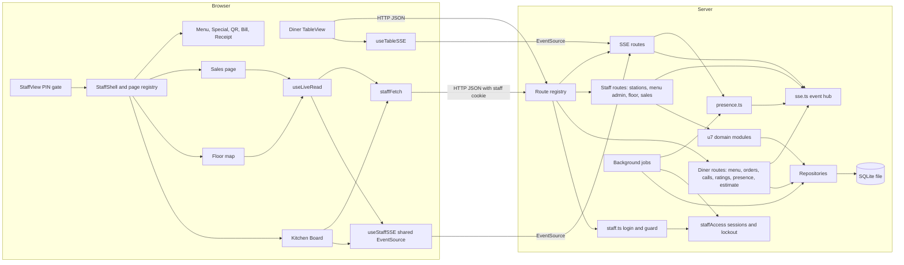
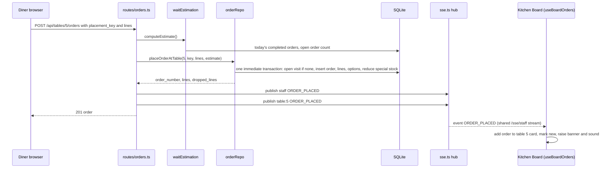
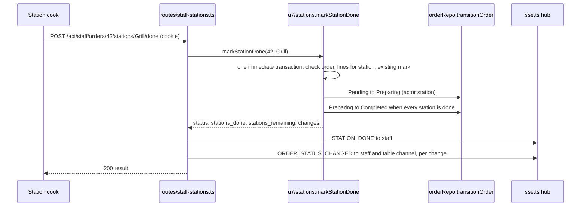
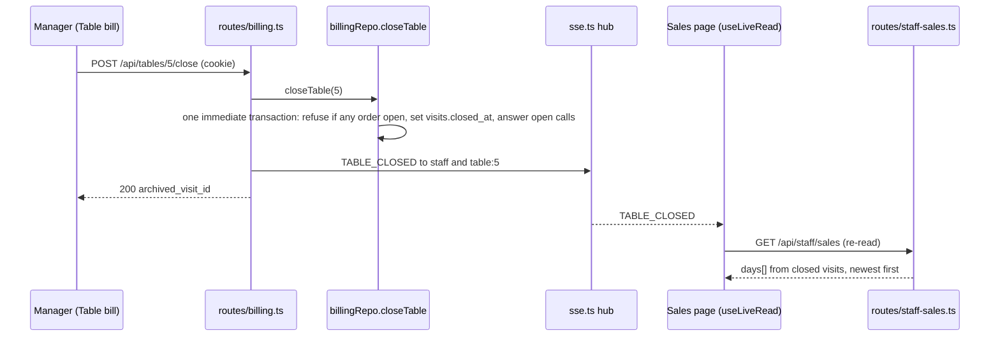
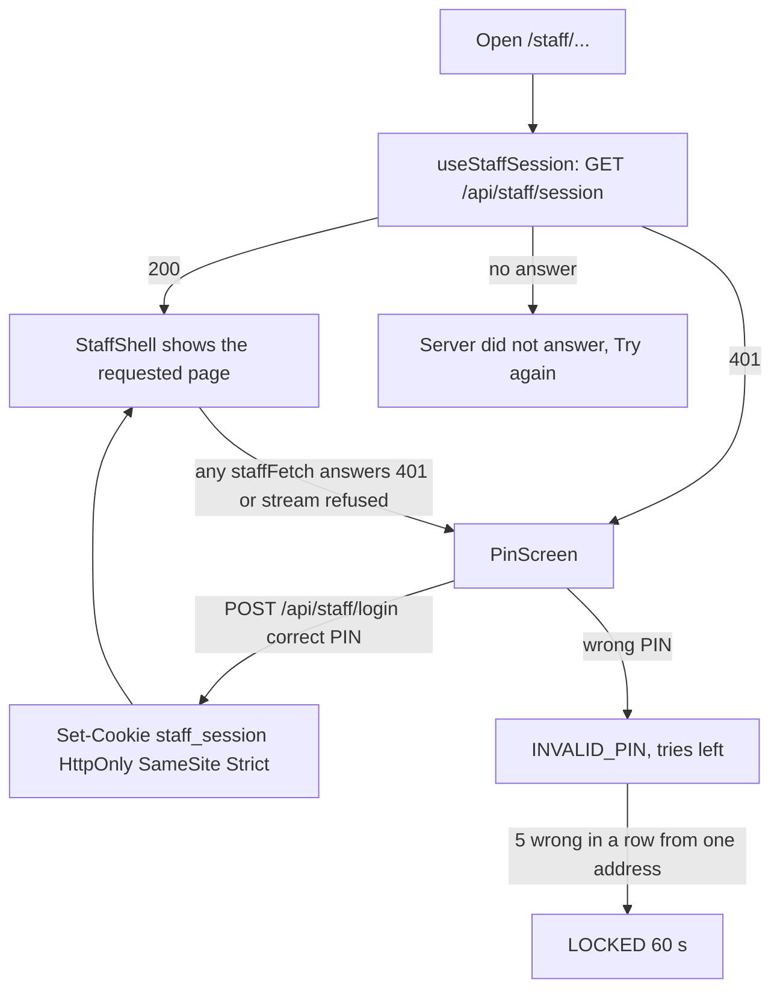

# Architecture: table-order

## Architecture Analysis

### System Overview

One Node.js process serves everything: an Express JSON API under `/api`, Server-Sent Events under `/sse`, and the built React single-page app from `dist/` (with an `index.html` fallback for every other path). Data lives in one SQLite file opened with better-sqlite3 (synchronous, WAL mode). Live state that does not need to survive a restart (staff sessions, login lockouts, diner page presence, SSE subscribers and their replay buffers) lives in server memory.

The browser app has two halves selected by path: the diner app at `/table/:id` (phone-shaped column, bottom tab bar) and the staff app at `/staff/*` (PIN gate, then a shell with side navigation and pages from a registry).

### Architectural Style

**Modular monolith, layered.** Evidence:
- One deployable (`npm start` runs `tsx src/server/index.ts`), one database file, no network calls between parts
- Server layers: routes (`src/server/routes/`) validate input, call repositories or domain modules, publish events after a successful write, and map errors to the `{ error: { code, message, details? } }` envelope; repositories (`src/server/repositories/`) own SQL and business rules; small domain modules (`routes/u7/*.ts`, `services/waitEstimation.ts`, `presence.ts`, `staffAccess.ts`) hold the rest
- Extension points were built in for parallel build Units: a route registry (`routes/registry.ts`), a staff page registry (`client/staff/pages/registry.tsx`) and a diner feature registry (`client/diner/features/registry.ts`). New work is added by adding an entry, not by editing shared code paths
- Push-based UI: every write that changes what someone sees publishes an SSE event; screens either apply the event directly (Kitchen Board, bill) or re-read their route on the relevant events (`useLiveRead`)

### Component Relationships

Text fallback: The browser has a diner app (TableView with its own table stream) and a staff app (PIN gate, then StaffShell with registered pages). Staff pages either build state from the shared staff stream (Kitchen Board) or re-read their route when an event arrives (Floor map, Sales via useLiveRead); every staff request goes through staffFetch, which returns the screen to the PIN screen on a 401. On the server, the route registry mounts the staff login and guard first, then diner routes, staff routes and the SSE routes. Routes call repositories and domain modules, which use the SQLite file. Routes, presence tracking and the background jobs publish through the in-memory event hub, which writes to every subscribed stream.

### Data Flow

1. **Order placement**: diner POSTs `/api/tables/:id/orders` with a placement key and lines. The route validates shape, computes the wait estimate, then `placeOrderAtTable` opens the visit if needed and writes the order, lines, options and any special stock reduction in one immediate transaction. After the commit the route publishes `ORDER_PLACED` to `staff` and `table:<id>`, and `SPECIAL_CHANGED` when stock changed.
2. **Kitchen progress**: staff mark a station done (`POST /api/staff/orders/:n/stations/:s/done`) or change status directly (`POST /api/orders/:n/transition` with `by=staff`). All status changes go through `transitionOrder` (one legal-transition table); `completed_at` is set on Completed. Events `STATION_DONE` and `ORDER_STATUS_CHANGED` follow the write.
3. **Close and sales**: staff close a table (`POST /api/tables/:id/close`); the visit gets `closed_at`, its open calls are answered, `TABLE_CLOSED` is published. Sales are computed on read by `getSales()` from closed visits only.
4. **Menu changes**: staff menu writes publish `MENU_CHANGED` (or `MENU_AVAILABILITY_CHANGED`) to staff and to every table channel; `watchSpecial` adds `SPECIAL_CHANGED` when the live special changes as a side effect.
5. **Presence**: each diner page opens `/sse/tables/:id?page=<id>` and sends heartbeats; presence counts feed the floor state and `TABLE_PRESENCE_CHANGED` (debounced to once a second per table).
6. **Reconnects**: SSE events carry rising ids and each channel keeps the last 60 for `Last-Event-ID` replay; staff screens also re-read their data each time their stream reconnects.

### Key Design Decisions

| Decision | Implication |
|---|---|
| Single process, SQLite, plain HTTP on the local network | Nothing to host; no horizontal scaling; sessions and presence reset on restart |
| Write, then publish (BR9.1) | Events never announce data that was rolled back; clients may briefly miss an event and recover by re-reading on reconnect |
| One shared `EventSource` per staff page | Avoids the browser's ~6 connections per host limit; every new staff screen should subscribe through `useStaffSSE`, never open its own stream |
| Event names registered once in `eventNames.ts` | A new event type must be added there or browsers silently ignore it |
| Staff guard mounted inside `staff.ts`, listed before staff route modules | Every later `/api/staff/*` route is protected automatically; a module listed before `staff` would not be |
| Staff stream does not refresh the idle timer (BR1.9) | A screen that only listens is signed out after 12 hours without a staff request |
| Additive-only schema upgrade (`upgradeSchema`, named steps) | New data needs a new step that adds a table or a column with a default; v1 data is never rewritten |
| Prices frozen on order lines; names read live from items | Money figures are historically exact; item names can drift after renames |
| Two stored time formats, read through `parseStoredTime` | Never compare stored times as text |
| Registries for routes, staff pages and diner features | Parallel Units could build without editing the same lines; new pages follow the same pattern |

### Improvement Opportunities

- An aggregated "open orders across all tables" read would replace the Kitchen Board's one-request-per-table load and could serve other live overviews
- `getSales()` and `getRatings()` scan all history; a day-bounded query (using the `orders_completed` index or a `visits.closed_at` range on parsed times) would keep them cheap as history grows
- Unify route error mapping on `AppError` and one status map
- Remove the dead `staff-qr` 501 stub and `PagePlaceholder`
- Persist staff sessions if devices must survive restarts, or document a re-sign-in flow for unattended screens
- Add a linter config and a CI run of `npm test && npm run test:e2e`

## Interaction Diagrams

### Placing an order and seeing it on the Kitchen Board

Text fallback: The diner posts the order. The route asks the wait estimation for the current estimate, then the order repository opens the visit if needed and writes the order, its lines, options and any special stock change in one transaction. After the commit the route publishes ORDER_PLACED to the staff channel and the table's channel and answers 201. The Kitchen Board receives the event on the shared staff stream, adds the order to the table's card and raises the new-order banner.

### A station marks its part done

Text fallback: The cook presses "Grill done". The route checks the station name and order number and calls markStationDone, which in one transaction checks the order and the existing marks, writes the mark, and moves the order to Preparing and, when every station with lines is done, to Completed through the single transition function. The route then publishes STATION_DONE and one ORDER_STATUS_CHANGED per change, and answers.

### Closing a table and the sales page

Text fallback: The manager closes the table from its bill. The billing repository refuses while any order is open, otherwise stamps the visit closed and answers its open service calls in one transaction. The route publishes TABLE_CLOSED. The sales page, listening through useLiveRead, re-reads GET /api/staff/sales, which recomputes every day's totals from closed visits.

### Staff sign-in gate

Text fallback: Every staff address first asks GET /api/staff/session. A 200 shows the shell and the requested page; a 401 shows the PIN screen; no answer shows a retry message. A correct PIN sets an HttpOnly, SameSite=Strict session cookie and shows the shell. Wrong PINs count per client address and lock it for 60 seconds after five. Any later 401 from a staff request, or a refused staff stream confirmed by the session check, returns to the PIN screen.
