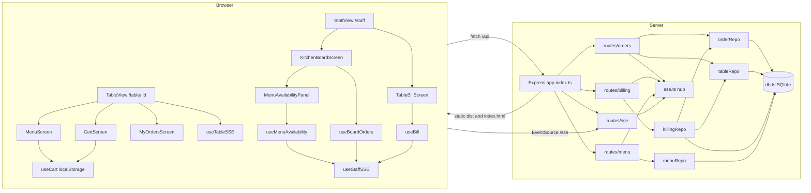
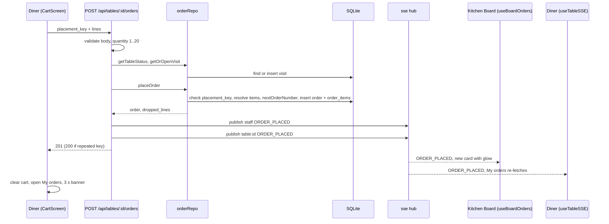
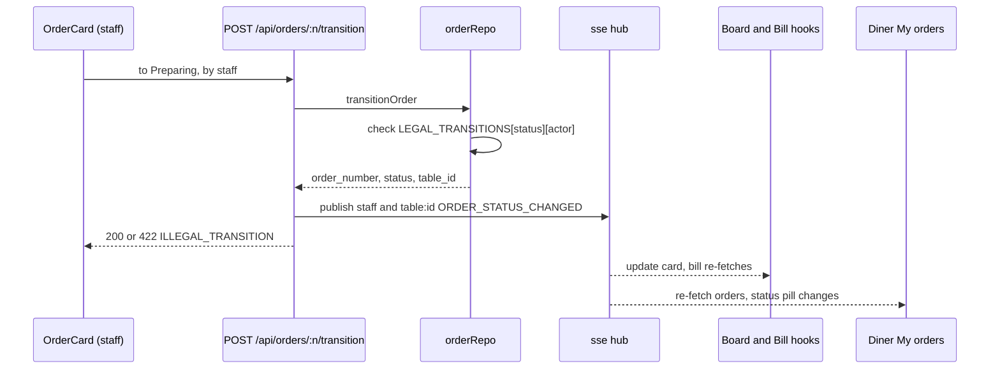
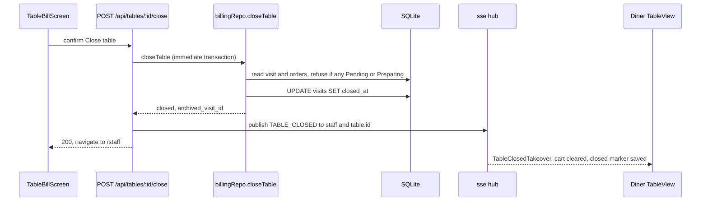

## Architecture Analysis

### System Overview

One npm package holds a Node.js/Express server and a React single-page app. The server exposes a JSON REST API under `/api`, two Server-Sent Events streams under `/sse`, and serves the built client from `dist/` for every other path. Data lives in one SQLite file through `better-sqlite3` (synchronous calls). There is no external service, queue, cache, auth provider or background job.

### Architectural Style

Layered monolith, single process, single node.
- Evidence: `src/server/index.ts` mounts routers and static files in one Express app; routes call repositories; repositories call `getDb()` (a module singleton in `src/server/db.ts`); live events use in-memory structures in `src/server/sse.ts`.
- Clean layering on the server: route (validation, status codes, publishing events) -> repository (SQL, rules) -> database. Routes publish events after the repository call succeeds.
- Client: route-level views (`TableView`, `StaffView`) -> screens -> components, with data hooks (`useCart`, `useBoardOrders`, `useBill`, `useMenuAvailability`, `useTableSSE`, `useStaffSSE`). No global store, no data-fetching library: each hook uses `fetch` and local state.

### Component Relationships

Text fallback: the browser has two route trees (diner and staff); screens use hooks; hooks call `/api` with `fetch` and listen on `/sse` with `EventSource`. On the server, four routers call three-plus repositories which share one SQLite singleton; three routers publish to the in-memory SSE hub, and the SSE router subscribes connections to it.

### Data Flow

- **Write path**: a client POSTs; the route validates, calls a repository (SQL in one call or transaction), then calls `publish(channel, type, payload)`; the response returns. Event publication is not transactional with the database write.
- **Read path**: screens fetch on mount and re-fetch (or patch local state) when an event for their table arrives; on every SSE reconnect the staff hooks (`useBoardOrders`, `useBill`) and the diner (`TableView.checkTableReset`) reload so missed events do not leave stale data.
- **Cart** is client-only: `localStorage` key `cart:table:<id>`, placement key in `sessionStorage` `cart-placement-key:<id>`, last-seen closed visit in `localStorage` `cart-closed-marker:<id>`.
- **Channels**: `staff` receives every order, status, close and availability event; `table:<id>` receives events for that table plus availability changes for every table.

### Database Schema (SQLite, `src/server/db.ts`)

Created on every start with `CREATE TABLE IF NOT EXISTS`; pragmas `journal_mode = WAL`, `foreign_keys = ON`.

| Table | Columns | Notes |
|---|---|---|
| `tables` | `id` INTEGER PK, `label` TEXT, `status` TEXT default `'open'` | `status` is not read; table state is derived from `visits` |
| `categories` | `id` TEXT PK, `name`, `sort_order` INTEGER default 0 | seeded `c-01..c-04` |
| `items` | `id` TEXT PK, `category_id` -> categories, `name`, `description` default `''`, `price_cents` INTEGER, `image` TEXT default `''` (an emoji in seed data, or a URL), `available` INTEGER default 1 | seeded `i-01..i-12` |
| `visits` | `id` TEXT PK (UUID), `table_id` -> tables, `opened_at` TEXT default `datetime('now')`, `closed_at` TEXT NULL | open visit = `closed_at IS NULL`; timestamps are SQLite UTC text |
| `orders` | `id` INTEGER PK AUTOINCREMENT, `order_number` INTEGER UNIQUE, `visit_id` -> visits, `table_id` -> tables, `status` TEXT default `'Pending'`, `placed_by` TEXT default `'diner'`, `placement_key` TEXT, `placed_at` TEXT (ISO-8601 from app code), `UNIQUE(table_id, visit_id, placement_key)` | the unique key is the idempotency guard |
| `order_items` | `id` PK AUTOINCREMENT, `order_id` -> orders, `item_id` -> items, `quantity`, `unit_price_cents` | price frozen at order time |
| `order_counter` | `id` INTEGER PK `CHECK (id = 1)`, `next_order_number` default 1 | one row, `INSERT OR IGNORE` at init; incremented with `UPDATE ... RETURNING` |

**Migrations**: none. There is no version table, `PRAGMA user_version` or migration runner. Changes to a `CREATE TABLE` do not reach an existing database file. For v2 ("new tables or columns with defaults only, never wipe") the additive pattern is: new tables via `CREATE TABLE IF NOT EXISTS`, new columns via a guarded `ALTER TABLE ... ADD COLUMN ... DEFAULT ...` (check `PRAGMA table_info`) run from `initSchema`.

**Seed data** (`seedIfEmpty`, runs only when `tables` is empty, called from `index.ts` only when the file is the process entry point; tests call it themselves): 10 tables ("Table 1".."Table 10"), 4 categories (Starters, Mains, Desserts, Drinks), 12 items:
Garlic Bread 650, House Salad 850, Caesar Salad 950 (Starters); Classic Burger 1450, Grilled Salmon 1850, Margherita Pizza 1350, Pasta Carbonara 1250 (Mains); Chocolate Fondant 950, Creme Brulee 850 (Desserts); Sparkling Water 350, Fresh Orange Juice 450, House Coffee 400 (Drinks). `db.test.ts` asserts these counts, so v2 seed additions must not change them for v1's test unless the team chooses to.

### Live Events (SSE)

| Event | Published by | Channels | Payload |
|---|---|---|---|
| `ORDER_PLACED` | `POST /api/tables/:id/orders` (new order only) | `staff`, `table:<id>` | `order_number, table_id, visit_id, status, placed_at, lines[{menu_item_id,name,quantity,price_cents_each,subtotal_cents}], total_cents` |
| `ORDER_STATUS_CHANGED` | `POST /api/orders/:n/transition` | `staff`, `table:<id>` | `order_number, table_id, status` |
| `TABLE_CLOSED` | `POST /api/tables/:id/close` | `staff`, `table:<id>` | `table_id, archived_visit_id` |
| `MENU_AVAILABILITY_CHANGED` | `POST /api/menu/items/:id/availability` | `staff`, every `table:<n>` | `menu_item_id, available` |
| `HELLO` | on connect, that connection only | none (no id, not buffered) | `message` |

Mechanics (`src/server/sse.ts`): global counter starting at `Date.now()`; per-channel ring buffer of 60; replay of events newer than `Last-Event-ID` (header) or `?lastEventId=`; `retry: 2000`; `: keep-alive` every 20 s; headers `Content-Type: text/event-stream`, `Cache-Control: no-cache`, `X-Accel-Buffering: no`. A browser only receives named events it registered a listener for: `useTableSSE` registers the four above plus the unnamed `message`; `useStaffSSE` registers those four plus `TABLE_STATUS_CHANGED` (never published).

### How the Server Serves Pages

`express.static(distDir)` with `distDir = path.join(__dirname, '../../dist')`, then a catch-all `app.get('*')` that calls `res.sendFile('index.html', { root: distDir })`. The `{ root }` form is mandatory (a team rule): Express refuses an absolute path that passes through a dot-folder such as `.aidlc/worktrees/`. If `dist/index.html` is missing, the catch-all answers 200 with a small placeholder HTML page. The catch-all is registered after `/api` and `/sse`, so any new API or SSE router must be mounted before it. The server starts (`seedIfEmpty()` then `listen`) only when `index.ts` is the process entry point, so tests can import `app` without opening a port. Port: `PORT ?? E2E_PORT ?? 3000`.

### Styling Approach (design system and Dark mode input)

- Tokens live in `src/client/index.css` `:root` (single, dark-only theme): colours `--bg-primary #0f1216`, `--bg-secondary #171b22`, `--bg-card #1f2630`, `--bg-tab-bar rgba(15,18,22,.95)`, `--border #2a313c`, `--text-primary #f1f3f6`, `--text-secondary #a6aeb8`, `--text-muted #7b8491`, `--accent #ffb04a` (+ `--accent-hover`, `--accent-soft`, `--accent-fg`, `--accent-gradient`, `--accent-glow`), status colours `--status-pending #ffc75a`, `--status-preparing #4cb3ff`, `--status-completed #5dd48e`, `--status-cancelled #8a94a2` each with a `-soft` tint, `--danger #ff6b6b`, `--highlight-new`, `--tab-active`, `--tab-inactive`; shape `--radius-card 12px`, `--radius-pill 20px`, `--radius-sm 6px`; shadows `--shadow-card`, `--shadow-tab-bar`; motion `--transition-fast/normal`, `--ease-out`, `--ease-spring`; layout `--diner-max 520px`.
- There is no type scale, spacing scale or light theme token set. Font: system stack. A body gradient background (amber and blue radial glows) is set in CSS.
- Most component styling is inline `style={{}}` using `var(--token, #fallback)`; about 143 literal colour values remain in TSX (e.g. `#22c55e`, `#ef4444`, `rgba(234,179,8,...)`, `#eab308`, `rgba(255,255,255,0.08)` borders). A few components inject `<style>` strings (`TableBillScreen`, `NewHighlight`, shimmer in `MenuScreen` and `MyOrdersScreen`).
- Utility classes in `index.css`: `.screen-enter`, `.stagger` (uses `--i`), `.pop-in`, `.fade-in`, `.slide-up`, `.bump`, `.icon-hop`, `.status-flash`, `.hover-lift`, `.btn-primary`, `.live-dot`, `.diner-shell`, `.diner-fixed`, `.skeleton`, `.tab-indicator`, `.check-ring`, `.panel-slide`, `.table-link`, `.float`; keyframes for each.
- Accessibility and motion rules already in place: a global `@media (prefers-reduced-motion: reduce)` block that zeroes animation, transition and smooth scrolling; `:focus-visible` amber outline on buttons and links; 44 px touch area on key buttons; focus traps in `ConfirmModal` and `MenuAvailabilityPanel`; `role="alertdialog"` on the table-closed takeover; the Cart tab shows a count badge (`data-testid="cart-badge"`).
- Layout rules the team wants preserved: diner Menu/Cart/My orders as a bottom tab bar (`DinerTabBar`, fixed, `.diner-fixed`), "View cart" and "Place" bar above it, sticky category pills, "+ Add" pill with 44 px touch area, frosted (`backdrop-filter: blur`) bars. The diner is a phone column (max 520 px) centred on wide screens; staff screens are a responsive grid (`repeat(auto-fill, minmax(20rem, 1fr))`) and the bill is max 56 rem wide.

### Screens and Routes (client)

| Route | View | Screen(s) | Notes |
|---|---|---|---|
| `/table/:id` | `TableView` | `MenuScreen`, `CartScreen`, `MyOrdersScreen` (tabs `menu`, `cart`, `orders`; state in React, not in the URL) | header "Table <id>" with a live/reconnecting dot; order confirmation banners; table-closed takeover; reconnect banner after 3 s |
| `/staff` | `StaffView` (index route) | `KitchenBoardScreen` | "Kitchen Board", live dot "Updated live", Menu availability button |
| `/staff/tables/:id` | `StaffView` | `TableBillScreen` | "Table <id> — Bill", "← Board" link, Close table |
| `/`, any other path | redirect to `/staff` | | |

Tab and screen state is not in the URL; a diner reload returns to the Menu tab.

### Key Design Decisions

- **Visit model**: closing a table archives the visit instead of deleting orders, so history exists in the database for a future "past visits" feature; nothing reads it yet.
- **Idempotent order placement** via `UNIQUE(table_id, visit_id, placement_key)`; a repeat returns 200 with the original order and publishes nothing.
- **Frozen line prices** keep the bill right after a menu price change.
- **Events carry enough to patch local state, but screens still re-fetch** for diner My orders and the bill (simple and correct, slightly chatty).
- **Reconnect reconciliation** over guaranteed delivery: ring buffer is only 60 events, so hooks reload on reconnect.
- **Race guards** in `useBoardOrders` (fetches in flight record touched orders and closed tables) and `TableView.checkTableReset` (sequence numbers) prevent stale answers from overwriting newer live state.
- **Single-process in-memory SSE** keeps the code small; scaling beyond one process would need a shared bus.
- **Port and DB file from environment variables** so parallel worktrees never collide.

### Improvement Opportunities

- Add a migration step (versioned, additive) before v2 adds columns.
- Introduce a shared types module for `Order`, `OrderLine`, `OrderStatus`, `MenuItem`, status colours and money formatting (now duplicated).
- Move literal colours into tokens and add a light token set before Dark mode; add type and spacing scales for the design system.
- Add a staff authentication layer (PIN) and stop trusting `by` from the request body.
- Add an endpoint that lists tables so the board and a floor map need not hard-code 10 tables and make 10 requests.
- Add lint, type-check script and CI.

## Interaction Diagrams

### Diner places an order

Text fallback: the diner posts the cart; the route validates, opens or reuses the visit, `placeOrder` freezes prices and numbers the order, the route publishes `ORDER_PLACED` to the staff and table channels and answers 201; the board shows a new card and the diner's My orders reloads.

### Staff moves an order and the diner sees it

### Staff closes a table

Error exits: 409 `TABLE_ALREADY_CLOSED`, 422 `CLOSE_BLOCKED` (with blocking order numbers) and `TABLE_EMPTY`, each mapped to a message on the bill screen.

### Sold-out toggle

Staff panel -> `POST /api/menu/items/:id/availability` -> `menuRepo.updateItemAvailability` -> publish `MENU_AVAILABILITY_CHANGED` to `staff` and each of the 10 `table:<n>` channels -> every open Menu screen marks the item "Sold out"; an order submitted before the diner noticed has that line dropped with reason `SOLD_OUT_AT_SUBMIT`.
