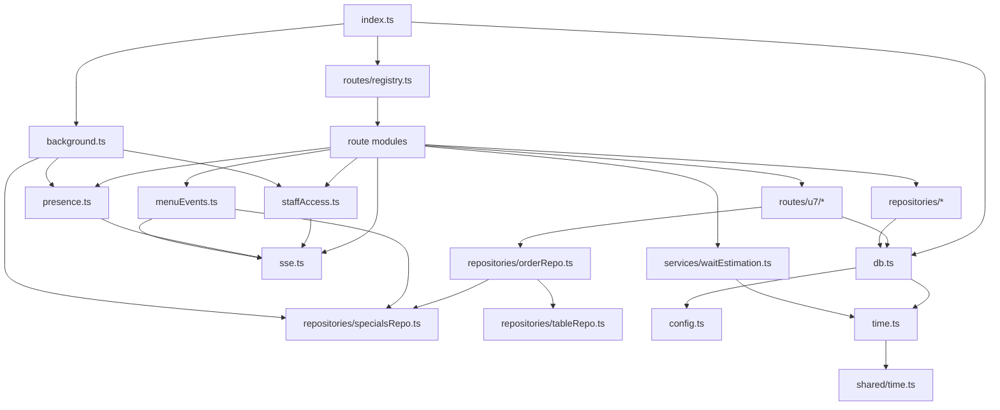
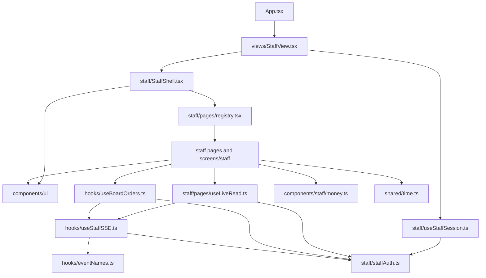

# Dependencies: table-order

## External dependencies

### Production (`dependencies`)

| Package | Range | Used in | Why |
|---|---|---|---|
| express | ^4.18.3 | `src/server/**` | HTTP server and routing |
| better-sqlite3 | ^13.0.0 | `src/server/db.ts` and every repository | Persistence |
| react | ^18.3.1 | `src/client/**` | UI |
| react-dom | ^18.3.1 | `src/client/main.tsx` | Rendering |
| react-router-dom | ^6.22.3 | `App.tsx`, `StaffShell.tsx`, `SideNav.tsx`, staff pages | Routing and nav links |
| qrcode | ^1.5.4 | `src/client/staff/pages/qr/TableQr.tsx` | QR drawing in the browser |
| @fontsource-variable/inter | ^5.3.0 | `src/client/index.css` | Font |

### Development (`devDependencies`)

Build and run: `vite`, `@vitejs/plugin-react`, `tsx`, `typescript`, `concurrently`. Tests: `vitest`, `@vitest/coverage-v8`, `jsdom`, `@testing-library/react`, `@testing-library/user-event`, `@testing-library/jest-dom`, `supertest`, `@playwright/test`. Types: `@types/better-sqlite3`, `@types/express`, `@types/node`, `@types/qrcode`, `@types/react`, `@types/react-dom`, `@types/supertest`. Versions are in `technology-stack.md`.

### External services

None. No network call leaves the machine: no payment provider, no analytics, no font CDN, no QR service. Browsers load everything from the same origin.

### Dependency observations

- `tsx` is a devDependency but `npm start` uses it in production; an install with `--omit=dev` cannot start the server
- `better-sqlite3` is a native module: installs need a matching prebuilt binary or a build toolchain
- `@types/express` ^4 matches express ^4; `vitest` ^1 with `@vitest/coverage-v8` ^1 match
- `jsdom` ^29 and `@testing-library/jest-dom` ^7 are much newer majors than the Vitest 1 line; the setup file works around jest-dom 7's global `expect` (`src/test-setup.ts`)

## Internal dependencies

### Server module graph

Text fallback: `index.ts` loads the route registry, background jobs and the database. Route modules depend on staff access, the SSE hub, repositories, the U7 domain modules, menu events, presence and wait estimation. U7 modules use the order repository and the database. Repositories use `db.ts`; the order repository also uses the specials and table repositories. Staff access, presence and menu events publish through `sse.ts`. `sse.ts` imports nothing from the app: staff access registers its session check with it at load (`setSessionValidator`), which avoids an import cycle. `db.ts` uses config and time; time re-exports the shared time reader.

No circular imports were found in the server.

### Client module graph (staff side)

Text fallback: `App.tsx` routes `/staff/*` to `StaffView`, which uses the session hook (and through it `staffAuth`) and shows `StaffShell`. The shell renders pages from the page registry with the UI kit. Pages read data through `useLiveRead` or `useBoardOrders`, both built on the shared `useStaffSSE` stream and `staffFetch`. `useStaffSSE` registers the event names from `eventNames.ts` and calls back into `staffAuth` when the stream is refused. Pages also use the UI kit, money formatting and the shared time reader.

### Cross-side dependencies

- `src/shared/` is imported by both server (`src/server/time.ts`, `services/waitEstimation.ts`) and client (`staff/board/TicketTimer.tsx` uses `parseStoredTime`, `diner/features/tracker/index.tsx` uses `waitDisplay`); it must stay free of Node-only and DOM-only code
- The client depends on the server only through HTTP and SSE contracts (see `api-documentation.md`); no server module is imported by the client and vice versa
- Client and server each keep their own copy of some constants: stations (`config.ts` STATIONS vs `staff/board/constants.ts` STATION_NAMES), floor state names, and response types (redeclared as TypeScript interfaces on the client side). A contract change must be made on both sides

### Test dependencies on production code

- Server tests import repositories and routes directly and use test-only exports: `_resetForTest` (`sse.ts`), `resetStaffAccessForTest`, `resetLoginAttemptsForTest`, `_staffAccessSizes` (`staffAccess.ts`), `setPresenceForTest`, `resetPresenceForTest` (`presence.ts`), `resetDb` (`db.ts`)
- Browser tests depend on the built `dist/`, on `STAFF_PIN=4242` and on `DB_FILE=:memory:` set by `playwright.config.ts`
- Tests assert the dead `staff-qr` stub (`foundation/guard.test.ts`, `foundation/routeOrder.test.ts`), so removing it needs those tests updated

## Impact notes for the Manager TV wall

| Change | Touches | Blast radius |
|---|---|---|
| New staff page and nav link | `staff/pages/registry.tsx` (+ maybe `Icon.tsx` mapping) | Low in code, but `staff/__tests__/StaffShell.test.tsx` (lines 38, 52, 60) asserts the exact page keys, nav labels and non-nav keys, so it changes and is listed as a changed v2 test |
| Full-screen route outside the shell | `App.tsx` and/or `StaffView.tsx` | Medium: every staff page passes through `StaffView`; PIN gate behaviour must stay the same |
| New `/api/staff/...` read | new route module + `routes/registry.ts` entry | Low if listed after `staff`. `foundation/routeOrder.test.ts` requires `staff` before the U7 modules and exactly five modules with `owner: 'U7'`, and `u7/routeOrder.test.ts` expects five U7 modules, so a new module needs its own `owner` value (the `RouteModule.owner` type is `'v1' \| 'U5' \| 'U7'` and must be widened) |
| New SSE event type | publisher + `hooks/eventNames.ts` | Medium: `hooks/__tests__/liveHooksV2.test.ts` asserts the exact `EVENT_NAMES` list and that `STAFF_EVENT_NAMES` is that list plus `TABLE_STATUS_CHANGED`, so adding a name changes an existing v2 test (to be listed as a changed test). Re-reading on existing events avoids this |
| Server-wide setting | new `upgradeSchema` step in `db.ts` | Medium: `foundation/dbUpgrade.test.ts` checks the upgrade is additive and repeatable |
| Reusing `getSales()` | `routes/u7/sales.ts` | Medium: shared with the Sales page; changing its semantics changes that page |
