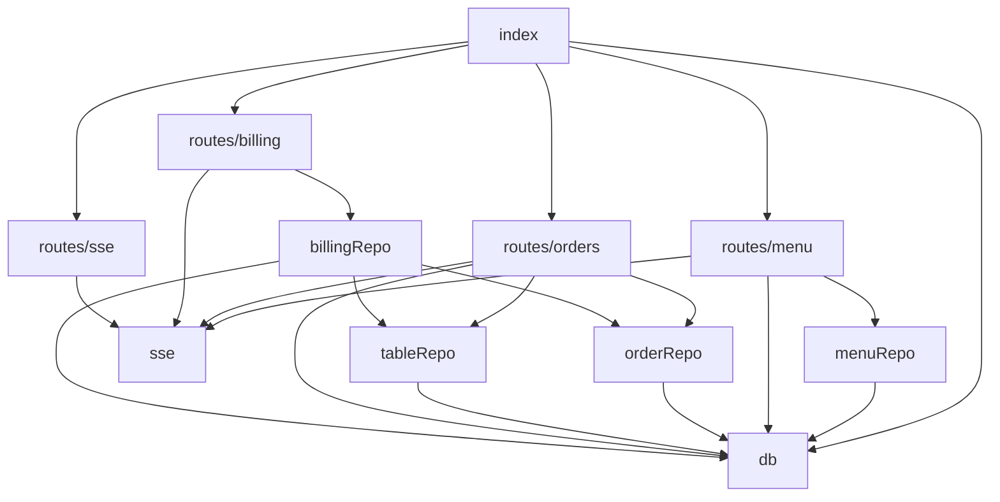

# Dependencies

## External Dependencies

Declared in `package.json` (see `technology-stack.md` for the full list with ranges and use). Points that matter for planning:

| Dependency | Risk or note |
|---|---|
| better-sqlite3 `^13.0.0` | native addon compiled per Node version; synchronous API blocks the event loop (fine at this scale); the only datastore |
| express `^4.18.3` | v4 line; `res.sendFile` rejects absolute paths through dot-folders (why `{ root: distDir }` is used) |
| react / react-dom `^18.3.1`, react-router-dom `^6.22.3` | stable; routing is plain `BrowserRouter` (needs the server catch-all for deep links) |
| vite `^5`, vitest `^1.4`, jsdom `^29`, @testing-library/jest-dom `^7`, @playwright/test `^1.42` | mixed generations (vitest 1.x with newer jsdom and jest-dom); `src/test-setup.ts` imports jest-dom matchers explicitly because jest-dom v7 cannot extend a global `expect` in a node environment |
| `package-lock.json` | present; not read |

No dependency audit was run (read-only scan). No outbound network calls exist in the app code: no third-party APIs, analytics, fonts, CDNs or image hosts (menu images are emoji strings; an `https://` or `data:image` value would be rendered as an `` by `MenuScreen`'s `isImageAddress`).

Browser APIs relied on: `EventSource`, `fetch`, `localStorage`, `sessionStorage`, `IntersectionObserver`, `CustomEvent`, `matchMedia`-free reduced motion via CSS only, `backdrop-filter`.

Candidates a v2 feature would bring in, none present today: a QR-code generator, a PIN hashing helper (Node `crypto` is available), a charting approach for sales, a date library (the code formats dates by hand).

## Internal Dependencies

### Server (acyclic)

Text fallback: `index.ts` mounts four routers; routers use repositories and the SSE hub; `billingRepo` reuses `orderRepo` and `tableRepo`; every repository uses `db`. `routes/orders` and `routes/menu` also reach into `db` directly (`getCurrentVisit`, a `SELECT id FROM tables`), a small layering leak.

### Client

- Views: `TableView` -> hooks `useTableSSE`, `useCart` and three diner screens plus `DinerTabBar`, `TableClosedTakeover`. `StaffView` -> two staff screens.
- Staff hooks all sit on `useStaffSSE`: `useBoardOrders`, `useBill`, `useMenuAvailability`. Each call opens its own `EventSource`, so the board with the panel open holds two `/sse/staff` connections and a bill screen another.
- `useBill` takes the `OrderStatus` type from `useBoardOrders`.
- `useCart` is used by `TableView`, `MenuScreen` and `CartScreen`; instances sync through the `cart-updated` window event and `localStorage`.
- Shared UI: `ConfirmModal` (diner and staff), `money.ts` (staff only).
- No circular imports found.

### Cross-cutting couplings to keep in mind

- Server event type names and client listener lists must agree (see `architecture.md`): a new event needs an entry in `useTableSSE.ts` and/or `useStaffSSE.ts`.
- Mockup-match specs read v1's mockup preview from `aidlc/spaces/default/intents/261105-table-order-app/inception/refined-mockups/preview.html`, so v1's record folder must stay in place.
- Status strings (`Pending`, `Preparing`, `Completed`, `Cancelled`) are repeated in SQL, `orderRepo`, `tableRepo`, `billingRepo`, three client hooks/components and many tests.
- Seed ids (`i-01..i-12`, `c-01..c-04`, tables 1 to 10) are used by `DEFAULT_CATEGORIES` in `MenuScreen`, `TABLE_COUNT` in `useBoardOrders`, and many e2e specs.
