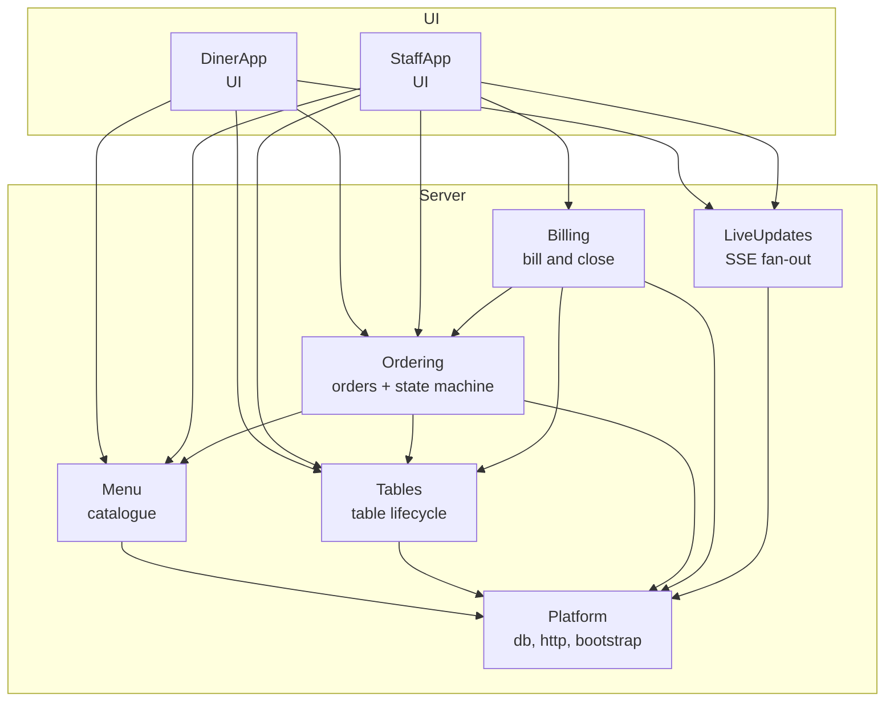

# Components — Table Order Web App

**Based on:** `requirements.md` from `inception/requirements-analysis/`, `stories.md` from `inception/user-stories/`, `mockups.md` from `inception/refined-mockups/`.

## Sources

- [desc] Initial description: "Build the Table Order web app based on ideas/table-order/IDEA.md"
- [scope] Workflow-selected scope: `dpl-workshop`.

## Scope of this stage

Domain Design identifies the **logical building blocks** of the system — code we write — and assigns each entity to exactly one owning component. Deployment topology, tech stack details and NFR patterns come in later stages.

## Preferred decomposition: Option A — 8 components

A balanced split by business responsibility. Each rule lives in one place, no dependency cycles, and after the walking skeleton U2 (diner screens), U3 (kitchen board) and U4 (bill and close) can be built in parallel. See `decisions.md` ADR-001 for the full trade-off against Options B and C.

### Component diagram (Mermaid)



### Text fallback

- UI → Ordering, Menu, Tables, LiveUpdates (both DinerApp and StaffApp read via HTTP and listen via SSE).
- StaffApp also → Billing.
- Server flow: Ordering depends on Menu + Tables; Billing depends on Ordering + Tables; every server component depends on Platform.
- No cycles. LiveUpdates is a fan-out port; nothing on the server depends on it for correctness.
- **Publisher wiring:** Ordering, Menu and Billing publish events to LiveUpdates via a `publish(event)` port injected by Platform's bootstrap. This is why `LiveUpdates` is not in their `depends_on` list: they call an abstraction, not LiveUpdates directly, and can be tested with a fake publisher. Platform wires the real LiveUpdates publisher at start-up.

### Component catalogue (YAML)

```yaml
components:
  - name: Platform
    kind: library
    owns: [db-connection, http-server, env-config, bootstrap]
    responsibilities:
      - Load configuration from environment variables (PORT, E2E_PORT, DB_FILE)
      - Open the SQLite database and run migrations on first start
      - Seed 10 tables, 4 categories and 12 items on an empty database
      - Expose an Express app factory and a start() function
      - Serve the built DinerApp/StaffApp bundles via `res.sendFile('index.html', { root: distDir })`
    depends_on: []

  - name: Menu
    kind: service
    owns: [Category, MenuItem, Availability]
    responsibilities:
      - Read the catalogue (categories + items)
      - Mark an item sold out and back again
      - Publish availability changes to LiveUpdates
    depends_on: [Platform]

  - name: Tables
    kind: service
    owns: [Table, Visit]
    responsibilities:
      - Open a visit when the first order is placed at a table
      - Archive the visit and reset the table on close
      - Expose table state (has_open_orders, has_any_orders) so Billing can decide the Close action
    depends_on: [Platform]

  - name: Ordering
    kind: service
    owns: [Order, OrderLine, OrderStatus]
    responsibilities:
      - Create an order from a validated cart (1..20 per line)
      - Drop sold-out lines at submit time and report which ones were dropped
      - Transition status (Pending → Preparing → Completed; Pending or Preparing → Cancelled)
      - Refuse illegal transitions (e.g. Completed → anything, Pending backwards)
      - Publish status changes to LiveUpdates
    depends_on: [Menu, Tables, Platform]

  - name: Billing
    kind: service
    owns: [Bill, CloseAction]
    responsibilities:
      - Build the itemised bill for a table (orders grouped by number; cancelled orders excluded)
      - Decide whether Close is available (every order Completed or Cancelled AND at least one order exists)
      - Close a table: archive the visit via Tables, publish TABLE_CLOSED to LiveUpdates
    depends_on: [Ordering, Tables, Platform]

  - name: LiveUpdates
    kind: service
    owns: [EventStream, EventBuffer]
    responsibilities:
      - Hold a 1-hour ring buffer of events per channel for reconnect catch-up
      - Expose an SSE endpoint per channel (table:<id>, staff)
      - Auto-reconnect and replay missed events on client reconnection
    depends_on: [Platform]

  - name: DinerApp
    kind: ui
    owns: [DinerRouter, MenuScreen, CartScreen, MyOrdersScreen, TableClosedTakeover, CartStore]
    responsibilities:
      - Render the diner routes at `/table/:id`
      - Keep the cart in `localStorage` (per device, survives refresh)
      - Subscribe to the table's SSE channel
      - Apply the TABLE_CLOSED takeover and clear local state
    depends_on: [Menu, Ordering, Tables, LiveUpdates]

  - name: StaffApp
    kind: ui
    owns: [StaffRouter, KitchenBoardScreen, MenuAvailabilityPanel, TableBillScreen]
    responsibilities:
      - Render the staff routes at `/staff` and `/staff/tables/:id`
      - Subscribe to the staff SSE channel
      - Issue status transitions, availability toggles, and the Close action
    depends_on: [Menu, Ordering, Tables, Billing, LiveUpdates]
```

## Entity ownership (one owner per entity)

| Entity | Owner |
|---|---|
| Category | Menu |
| MenuItem | Menu |
| Availability | Menu |
| Table | Tables |
| Visit | Tables |
| Order | Ordering |
| OrderLine | Ordering |
| OrderStatus | Ordering |
| Bill | Billing |
| CloseAction | Billing |
| EventStream | LiveUpdates |
| EventBuffer | LiveUpdates |
| DinerRouter, MenuScreen, CartScreen, MyOrdersScreen, TableClosedTakeover, CartStore | DinerApp |
| StaffRouter, KitchenBoardScreen, MenuAvailabilityPanel, TableBillScreen | StaffApp |

## Walking-skeleton stance (U1)

U1 ships Platform, the shells of DinerApp and StaffApp, and the full Ordering + LiveUpdates server contracts. This is what every other Unit depends on, so the parallel build of U2/U3 and the later U4 can proceed from U1 without further shared refactors. [team: project.md > Walking Skeleton]

| Unit | Components built or extended |
|---|---|
| U1 u1-walking-skeleton | Platform (full), Ordering (contracts + minimal state machine), LiveUpdates (full), Tables (open/archive only), Menu (read catalogue), DinerApp (shell + routing), StaffApp (shell + routing) |
| U2 u2-diner-screens | DinerApp (Menu, Cart, My orders, TableClosedTakeover), extends Menu/Ordering readers |
| U3 u3-kitchen-board | StaffApp (Kitchen Board + Menu Availability panel), extends Ordering transitions, Menu availability toggle |
| U4 u4-bill-and-close | Billing (full), StaffApp (Table Bill screen + Close), extends Tables close action |

## Rationale summary

Option A is the recommended split because:
- Each rule lives in one place (ordering invariants in Ordering, availability in Menu, close invariants in Billing). No duplicated validation.
- The dependency graph is acyclic and every arrow points toward Platform, which is independently buildable as U1.
- The seams between components line up 1:1 with the Unit DAG, so U2, U3 and U4 can be built in parallel after U1 with no cross-Unit refactors. [team: project.md > Construction]
- LiveUpdates is a port, not a hub: components publish to it but no component depends on it for correctness.
- Option B (merge Tables + Billing into Ordering) creates one large component and blocks the parallel build of U4. Option C (one Restaurant server component) puts every rule in one place and blocks every parallel build except the screens. See `decisions.md` ADR-001 for the full trade-off.

## Assumptions

- `image` holds the emoji. [assumption]
- Live updates keep one hour of events for catching up. [assumption]
- Types and validation detail are left to Functional Design. [assumption]
