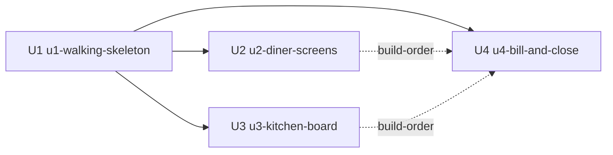

# Unit of Work — Table Order Web App

**Based on:** `components.md` and `decisions.md` from `inception/domain-design/`, `requirements.md` from `inception/requirements-analysis/`, `stories.md` from `inception/user-stories/`.

## Sources

- [desc] Initial description: "Build the Table Order web app based on ideas/table-order/IDEA.md"
- [scope] Workflow-selected scope: `dpl-workshop`.

## Settled by project rules (not asked)

Per `aidlc/spaces/default/memory/project.md`:
- Units are split by feature around a walking skeleton.
- U1 carries everything the other Units share.
- Every other Unit's code depends only on U1, never on another Unit.
- One app is started by one command (`npm install && npm start`).
- The app is split into exactly 4 Units, built as exactly 4 Bolts, one Bolt per Unit.
- U4's Unit lists U2 and U3 under `depends_on` as a build-order edge chosen by the team (Bolt 4 starts after Bolts 2 and 3 merge); U4's code still uses only U1.

## Units

| ID | Slug | Owns (components / major additions) | Kind |
|---|---|---|---|
| U1 | `u1-walking-skeleton` | Platform (full), Ordering (contracts + minimal state machine), LiveUpdates (full), Tables (open/archive only), Menu (read catalogue), DinerApp shell, StaffApp shell | packaging |
| U2 | `u2-diner-screens` | DinerApp screens: Menu, Cart, My orders, TableClosedTakeover; extends Menu/Ordering readers | ui |
| U3 | `u3-kitchen-board` | StaffApp screens: KitchenBoardScreen, MenuAvailabilityPanel; extends Ordering transitions + Menu availability toggle | ui |
| U4 | `u4-bill-and-close` | Billing (full), StaffApp Table Bill screen + Close action; extends Tables close | service |

```yaml
units:
  - name: u1-walking-skeleton
    kind: packaging
    depends_on: []
    summary: One-command startup, app shell, routing, SQLite with seed data, Order API, Server-Sent Events.
    components:
      - Platform
      - Menu
      - Tables
      - Ordering
      - LiveUpdates
      - DinerApp (shell + routing only)
      - StaffApp (shell + routing only)
    success_gate:
      - "npm install && npm start starts the app at http://localhost:3000"
      - "/table/5 loads the (empty) customer view"
      - "/staff loads the (empty) staff view"
      - "a client connected via EventSource to the SSE endpoint receives a test event within 2 seconds of publication"
      - "seed on an empty database creates 10 tables, 4 categories, 12 menu items"

  - name: u2-diner-screens
    kind: ui
    depends_on: [u1-walking-skeleton]
    summary: Diner's Menu, Cart and My orders screens, with the bottom tab bar, category pills, '+ Add' pill and live status updates.
    components:
      - DinerApp (all screens)
    success_gate:
      - "Diner can open /table/:id, browse the menu, add items, change quantities, and place an order"
      - "Cart survives a page refresh"
      - "My orders shows every order placed at the table during the current visit, with live status"
      - "A diner can cancel a Pending order"
      - "The TABLE_CLOSED takeover resets the device within 2 seconds"

  - name: u3-kitchen-board
    kind: ui
    depends_on: [u1-walking-skeleton]
    summary: Kitchen Board with per-table cards, status transitions, 'New' highlight, and the Menu availability side panel.
    components:
      - StaffApp (KitchenBoardScreen, MenuAvailabilityPanel)
      - Menu (availability toggle)
      - Ordering (forward transitions + cancel)
    success_gate:
      - "A newly placed order appears on the board within 2 seconds, highlighted"
      - "Status transitions Pending → Preparing → Completed work and are refused when illegal"
      - "Marking an item sold out reaches diners within 2 seconds"

  - name: u4-bill-and-close
    kind: service
    depends_on: [u1-walking-skeleton, u2-diner-screens, u3-kitchen-board]
    depends_on_reason: "Build-order edge chosen by the team: Bolt 4 starts after Bolts 2 and 3 merge. U4's code uses only u1-walking-skeleton."
    summary: Table Bill at /staff/tables/:id, Close table action and the full Billing component.
    components:
      - Billing (full)
      - StaffApp (Table Bill screen)
      - Tables (close action)
    success_gate:
      - "The bill lists every order with items, quantities, prices and subtotal, plus one combined total"
      - "Close table is disabled when any order is Pending or Preparing, or when the table has no orders"
      - "Closing a table archives the visit, resets the table, and the TABLE_CLOSED event resets every open diner device within 2 seconds"
```

## Edge block (Mermaid)



Solid arrows = code dependency; dashed arrows = build-order edge chosen by the team (not a code dependency).

## Walking-skeleton verification

The intent's Construction Verification Command is `npm test && npm run test:e2e`, from team Testing Posture. U1 must demonstrate the project's end-to-end result against this command before Bolts 2 and 3 start. [team: project.md > Testing Posture, Way of Working]

## Assumptions

- The four Units map 1:1 to four Bolts, one Bolt per Unit. [team: project.md > Construction]
- U4's `depends_on` lists U2 and U3 as a build-order edge; U4's code still only uses U1. [team: project.md > Construction]
- Each parallel Bolt runs in its own git worktree with its own `E2E_PORT` and `DB_FILE`. [team: project.md > Testing Posture]
