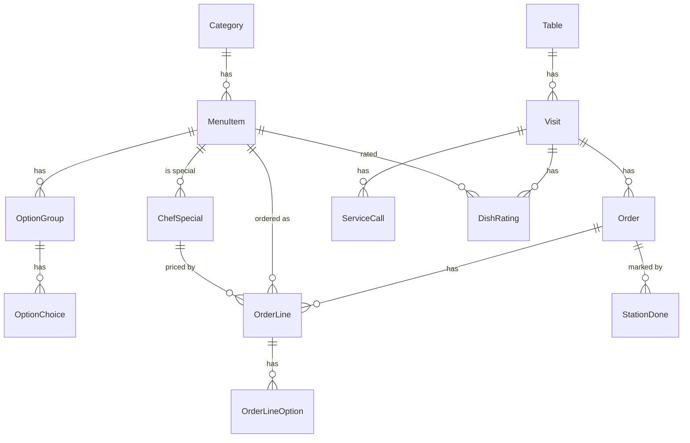

# Functional Specification: u5-foundation

The behaviour of the foundation Unit, in the order things happen. It is the source of truth for the workflows and state machines of U5; the data is in `entities.md` and the decision logic in `rules.md` (rule ids such as BR3.2 point there). U5 implements, in whole or in part, these stories (from `inception/units-generation/unit-of-work-story-map.md`): US1.1, US2.1, US3.1, US4.1, US5.1 (the Completed time), US6.1 (hidden items), US8.1, US9.1, US10.1, US11.1, US13.1 (station on lines), US17.1, US18.1 and US19.1. It follows the contracts in `inception/contract-design/contract-summary.md` and your answers: a page heartbeat for "Browsing" (Q1) and a 12-hour idle end for staff sessions (Q2). U5 builds no feature screen: U6 builds the diner features and U7 the staff features on top of it.

## Entity-Relationship View (derived from `entities.md`)

Text fallback: a Category has Menu items, which have option groups with choices; a Table has Visits, a Visit has Orders, calls and ratings; an Order has Lines (each with chosen options and possibly a Chef's special), and done marks per station.

## Workflows

### W1. Sign in as staff (US3.1; BR1.1 to BR1.8)

1. At start the server reads the PIN from the environment, or makes a random 4-digit one and prints it once (BR1.1).
2. Anyone opening a staff address first gets the shell's session check (BR1.8). With no session it shows only the PIN screen.
3. The person types 4 digits and presses Open. The page sends the PIN to the staff login route.
4. The server looks at the client address's count. If it is locked it answers 429 with the seconds to wait (BR1.4).
5. If the PIN is wrong it adds one to the address's count, answers 401 with the tries left, and the screen clears the digits and shows "That PIN is not right". On the fifth wrong try it locks the address for 60 seconds and the screen shows "Too many tries".
6. If the PIN is right it resets the count, makes a session, answers 204 with the cookie (BR1.2), and the screen opens the page that was asked for.
7. Every later staff request carries the cookie and refreshes the session's last action (BR1.3). A request with no valid session is answered 401 and the screen returns to the PIN screen (BR1.5, BR1.7). An open staff live stream does not refresh the idle time; it is re-checked at every 20-second keep-alive and closed when its session is gone (BR1.9).
8. Sign out removes the session, clears the cookie and closes the session's open staff streams.

### W2. Place an order with options (US8.1, US9.1, US11.1, US13.1; BR3.x, BR4.x, BR5.x)

1. The diner page posts the table's placement key and its lines, each with an item, a quantity, chosen option ids and, for a special, its id.
2. In one transaction the server finds or opens the visit, then for each line, in this order (BR3.1): checks the item is known and not hidden (else the whole order is refused UNKNOWN_ITEM), drops it if sold out (BR3.4), checks and prices the special (BR5.4, BR5.3), checks the options (an id that exists nowhere drops the line with OPTION_UNAVAILABLE; an id of another item, two choices in a choose-one group, or a missing required choice refuses the order with INVALID_OPTIONS), works out the frozen price (BR3.2) and freezes the station and chosen options on the line (BR3.3). The special's stock is reduced only after every line has passed these checks (BR5.3).
3. If no line is left the whole transaction is rolled back, including any stock reduction, and the answer is 400 EMPTY_ORDER (BR3.10).
4. Otherwise the API layer asks WaitEstimation for the estimate (BR4.1), the order stores it (BR3.5), and the answer is 201 with the lines, `dropped_lines` and `estimate_minutes`.
5. After the write succeeds the API publishes ORDER_PLACED to staff and the table (BR9.1), and SPECIAL_CHANGED if a special's stock changed (BR5.5).
6. A repeated placement key returns 200 with the same order, an empty `dropped_lines`, and publishes nothing (BR3.7).

### W3. Change an order's status (US3.1, US13.1; BR3.8)

1. A staff request (by=staff, with a session) or a diner request (by=diner) names an order and a target status.
2. The one transition function applies v1's rules (BR3.8). A change to Completed sets `completed_at` (BR3.6).
3. The caller publishes ORDER_STATUS_CHANGED to staff and the table. U7's station logic calls the same function: the first station done on a Pending order moves it to Preparing, and the last station done moves it to Completed.

### W4. Launch and run a Chef's special (US11.1; BR5.x)

1. Staff launch a special (item, price, stock 1 to 999, minutes 1 to 720). The server validates (BR5.1), ends any live special and creates the new one in one transaction.
2. SPECIAL_CHANGED is published to staff and every table.
3. While it is live, the current-special route returns it. A diner can order it (W2).
4. It ends when the stock reaches 0, the time passes (the server checks every 5 seconds), or staff end it. SPECIAL_CHANGED with no special is published (BR5.5).

### W5. Call the waiter or ask for the bill (US17.1; BR6.x)

1. A diner posts a call of a kind. With no open visit the answer is 409 NO_OPEN_VISIT. With an open request of that kind already, 200 with that request. Otherwise 201, and SERVICE_CALL_OPENED is published to staff and the table.
2. Staff respond. The request is marked responded, and SERVICE_CALL_RESPONDED is published.
3. When the table is closed, its open requests are marked responded in the same step (BR6.3).

### W6. Rate a meal (US18.1; BR7.x)

1. After Close table the diner page shows the dishes of the closed visit.
2. The page posts a thumb for each dish it rated. The server checks the visit, the dishes and the thumb (BR7.1), and saves or replaces each rating.
3. A post with `done: true` saves and locks them (BR7.2). Later posts are refused with 409 RATING_LOCKED.

### W7. Know a diner page is present (BR8.x)

1. A diner page makes a random page id, opens the table's live stream with it (the page parameter), and posts a heartbeat with the same id once when it opens and about every 60 seconds after.
2. The server keeps each page's last sign of life, keyed by page id. A page whose connection closes is removed at once; one quiet for 5 minutes stops counting (BR8.2).
3. Every 30 seconds a sweep drops pages quiet for more than 10 minutes, recounts every table, and publishes for each table whose count changed. The number of remembered pages is capped (500 per table, 5,000 in all).
4. When the count for a table changes, TABLE_PRESENCE_CHANGED is published to staff, at most once a second per table (BR8.3).

### W8. Choose a theme and set preferences (US2.1, US4.1, US10.1; BR10.2)

1. On open, the page reads the saved theme. None saved means follow the device (the stylesheet answers to the device's light or dark setting).
2. The person picks Follow device, Light or Dark (the staff header has the control; U6 adds it to the diner Settings sheet). The page sets the theme attribute on its root and saves or clears the choice.
3. Sound and allergies are saved the same way; blocked storage falls back to the defaults.

### W9. Start on any database (US19.1; BR11.1, BR11.2)

1. On every start the upgrade step creates any missing new table and adds any missing new column, then seeds only if the database is empty.
2. A v1 file keeps every row. Starting twice changes nothing.

### W10. Raise an alert (US4.1; BR9.3, BR9.4)

1. The shared alert logic receives an event that should alert (an order Completed for a diner's table; a new order for staff).
2. It checks the event has not fired before on this page and is newer than the page load.
3. It shows the banner; plays a short sound if the person has tapped the page and sound is on; vibrates where supported.

## State Machines

### Order status (unchanged from v1, plus Completed time)

| From | To | Who | Effect |
|---|---|---|---|
| Pending | Preparing | staff, or the first station done (U7) | event ORDER_STATUS_CHANGED |
| Pending | Cancelled | staff or diner | event |
| Preparing | Completed | staff, or the last station done (U7) | `completed_at` set; event |
| Preparing | Cancelled | staff | event |
| Completed, Cancelled | none | none | final |

### Chef's special

| State | Meaning | Moves to |
|---|---|---|
| Live | not ended, time not passed, stock above 0 | Ended (staff end, replaced, time passes, stock reaches 0) |
| Ended | no longer offered | none |

### Service call

| State | Meaning | Moves to |
|---|---|---|
| Open | raised by a diner | Responded (staff respond, or table closes) |
| Responded | cleared | none (a new request of that kind creates a new Open one) |

### Staff session

| State | Meaning | Moves to |
|---|---|---|
| Signed in | a valid cookie and recent action | Ended on sign-out, 12 hours idle, restart |
| Ended | no valid session | Signed in after a correct PIN |

### Rating

| State | Meaning | Moves to |
|---|---|---|
| Open | can be replaced | Locked when the diner presses Done |
| Locked | final | none |

## Rules Summary (derived from `rules.md`)

| Area | Rules |
|---|---|
| Staff access | BR1.1 to BR1.9: PIN from the environment, session cookie, 12-hour idle end, address lockout, guard on every staff route, the by-staff rule, return to the PIN screen, staff streams end with their session |
| Menu | BR2.1 to BR2.7: hidden items, stations, allergens, options, stable ids, seed, staff read |
| Orders | BR3.1 to BR3.10: options checked, frozen price, station and options, dropped lines, stored estimate, Completed time, replay, status rules, all or nothing |
| Estimate | BR4.1 to BR4.3: formula, "Running late", route |
| Specials | BR5.1 to BR5.5: launch, live, guarded stock, special pricing, events and expiry |
| Calls and ratings | BR6.1 to BR6.3 and BR7.1 to BR7.2 |
| Presence and events | BR8.1 to BR8.3 and BR9.1 to BR9.4 |
| Look and theme | BR10.1 to BR10.6 |
| Keeping v1 safe | BR11.1 to BR11.7 |
| Stations and speed | BR12.1 to BR12.2 and BR13.1 to BR13.2 |
| Seams and helpers | BR14.1 to BR14.4: guarded stubs (401 before 501), registries and mount points, test helpers, and the read routes the contract lists for U5 |

## Business Scenarios

- **Happy path:** a diner on a light phone customises a burger (Large, Extra cheese, No onions), sees the estimate, places the order; staff sign in with the PIN, see it on the new-look board and move it to Preparing, then Completed; the diner's page is told, the Completed time is recorded.
- **Unhappy path:** a guest types a wrong PIN five times and is locked out for a minute; a request without a session is refused with 401 and nothing changes.
- **Concurrency:** two diners order the last special at once: one gets it, the other's line is dropped with SPECIAL_SOLD_OUT and the rest of their order goes through.
- **Restart:** the server restarts; an open staff page's next request is refused and the screen returns to the PIN screen; a v1 database file starts with all its orders.

## Assumptions & Open Questions

- Which of the placement edge cases the Contract Design review raised are settled here: stock rollback (BR3.10), a mismatched or ended special (BR5.4), a removed option (BR3.4, BR2.5), a repeated key (BR3.7).
- The numbers (2 minutes per open order, 15 minutes starting value, 12 hours idle, 5-minute presence, 5-second expiry check) are starting values kept in one place.
- U6 and U7's own functional designs run after Bolt 5 is signed off and refer to this one for everything shared.
