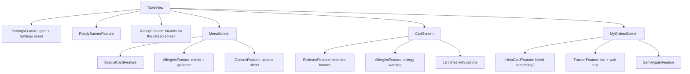

# Frontend Components: u6-diner-features

The components, state and screen-to-server links of the diner features. Behaviour is in `functional-spec.md` (workflows W1 to W10, rules D1 to D12); this file says which component does what, what it holds and what it calls. It builds on U5's shared components (`src/client/components/ui/`: Button, Pill, Chip, Badge, Timer, Banner, Sheet, Field, SegmentedControl, Tracker), hooks (`useTheme`, `useSoundPreference`, `useAllergies`), alert logic (`src/client/alerts/`) and shared wait helper (`src/shared/wait.ts`). No new package is needed.

## Component Hierarchy

Text fallback: `TableView` hosts the Settings gear, the ready banner and the thumbs. `MenuScreen` hosts the special card, the allergy marks and the options sheet. `CartScreen` hosts the estimate, the allergy warning and the option-aware lines. `MyOrdersScreen` hosts the call card, the tracker and "Same again".

## Components

| Component (folder under `src/client/diner/features/`) | Props | State it holds | Calls and listens to |
|---|---|---|---|
| `options/` OptionsSheet, `useOptionChoice` | `item`, `special?`, `onAdd(line)`, `onClose` | the chosen choice ids per group, the live price, the first missing required group | none; reads the menu item's groups from the menu already loaded |
| `allergies/` AllergyMark, AllergyWarning, `allergyHits(item, set)` | `item`, or `lines` and `onConfirm`, `onBack` | none (reads `useAllergies`) | none |
| `estimate/` EstimateBanner, `useEstimate(tableId)` | `tableId` | `estimate_minutes`, `basis`, loading and error | `GET /api/estimate?table=`; re-reads on `ORDER_PLACED` and `ORDER_STATUS_CHANGED` |
| `tracker/` OrderTracker | `order` | the shown wait text, refreshed every 30 seconds | none; uses U5's `Tracker` and `waitDisplay` |
| `ready-banner/` ReadyBanner | `tableId`, `events` | the banner shown or dismissed | U5's alert logic on `ORDER_STATUS_CHANGED`; sound and mute from `useSoundPreference` |
| `same-again/` SameAgainButton, `buildSameAgain(order, menu)` | `order`, `menu`, `onDone(result)` | busy while it works (the button is disabled) | none; matches each option by its label among the item's current choices (an order line keeps only label and price change), skips ambiguous or missing ones, adds to the cart through `useCart`, then opens the Cart tab |
| `help-card/` HelpCard, `useCalls(tableId)` | `tableId` | the open and answered calls of the current visit | `GET` and `POST /api/tables/{id}/calls`; `SERVICE_CALL_OPENED`, `SERVICE_CALL_RESPONDED`, `TABLE_CLOSED` |
| `special-card/` SpecialCard, `useCurrentSpecial` | `tableId`, `events`, `onAdd` | the live special and its countdown | `GET /api/specials/current`; `SPECIAL_CHANGED` |
| `rating/` RatingList, `useRatings(tableId)` | `tableId` | the dishes of the closed visit, each dish's thumb, done flag | `GET /api/tables/{id}/orders?visit=last_closed`, `POST /api/tables/{id}/ratings` |
| `settings/` SettingsSheet, SettingsButton | `tableId` | open or closed | U5's `useTheme`, `useSoundPreference`, `useAllergies` |

## Cart Model (`useCart`, W1 and W2, D1 to D3)

- A cart line holds: `lineId`, `menuItemId`, `name`, `basePriceCents`, `optionChoices` (the chosen choice ids with their group name, label and price change), `priceCents` (each, including options), `specialId?` and `quantity`.
- `lineId` is the item id, then `#` and the sorted choice ids joined by `+` when the line has choices, then `@` and the special id when it is a special line. A plain item's `lineId` is its item id, which is how v1 identified a line, so a cart stored by v1 loads as it is and a fresh add of the same plain item joins that line.
- Functions keep their v1 names where they still make sense (`addItem`, `updateQuantity`, `removeItem`, `clearCart`, `refreshPrices`, `ensurePlacementKey`) and take a `lineId` instead of an item id; `refreshPrices` becomes a refresh against the whole menu and the current special (D3) and returns what it removed, repriced or reset.
- The order sent is built from the lines: `{ menu_item_id, quantity, option_ids, special_id? }` per line.

## Interaction Flows

1. **Add with options:** "+ Add" on a card with options opens `OptionsSheet`; choices update the price; "Add to cart" calls `addItem` with the line and closes the sheet.
2. **Place order:** `CartScreen` checks the allergy hits; with hits it shows `AllergyWarning`; "Place order anyway" sends the order; the result's `dropped_lines` become a notice; success opens My orders.
3. **Live menu change:** `MENU_CHANGED`, `MENU_AVAILABILITY_CHANGED` or `SPECIAL_CHANGED` reloads the menu and, when the Cart is open or has lines, runs the cart refresh.
4. **Ready:** an `ORDER_STATUS_CHANGED` event to Completed for this table goes through the alert logic; a banner, vibration and sound follow.
5. **Closed:** `TABLE_CLOSED` shows v1's closed message and `RatingList` (it reads the dishes of the last closed visit).

## Form and Input Validation

| Input | Rule | Message |
|---|---|---|
| Required choose-one group | one choice needed before "Add to cart" | "Choose a <group name>" beside the group |
| Choose-one group | a second choice replaces the first | none |
| Quantity | 1 to 20 per line; a special line also at most its stock left | the plus button is disabled at the limit |
| Allergy chips | only the nine allergens | none |
| Calls | one open request per kind | the button is disabled with "Request sent" |
| Rating | thumb up or down only | "Could not save. Try again." on failure |

## API Integration Points

| Call | Used by | On failure |
|---|---|---|
| `GET /api/menu` (v1, extended by U5) | Menu, Cart refresh, Same again | v1's error view with Retry |
| `POST /api/tables/{id}/orders` | Cart | v1's retry banner; the same placement key is reused. `400 EMPTY_ORDER` (every line dropped, no `dropped_lines`) keeps the cart, runs the cart refresh and says nothing could be ordered; `400 INVALID_OPTIONS` runs the cart refresh and says an option needed attention |
| `GET /api/tables/{id}/orders?visit=current` and `visit=last_closed` (the second is U6's one server change) | My orders, Rating | an error line with Retry |
| `GET /api/estimate?table=` | Estimate | the banner shows "Estimate unavailable" and the order can still be placed |
| `GET /api/specials/current` | Special card | no card |
| `GET` and `POST /api/tables/{id}/calls` | Call card | "Could not send. Try again." |
| `POST /api/tables/{id}/ratings` | Rating | "Could not save. Try again." |
| Table events (`ORDER_PLACED`, `ORDER_STATUS_CHANGED`, `TABLE_CLOSED`, `MENU_AVAILABILITY_CHANGED`, `MENU_CHANGED`, `SPECIAL_CHANGED`, `SERVICE_CALL_OPENED`, `SERVICE_CALL_RESPONDED`) | all of the above | each screen reloads its data after a reconnect |

## Accessibility and Motion

Every control is at least 44 px and works from the keyboard; sheets trap focus, close with Escape and return focus to the control that opened them; status is shown in words as well as colour ("⚠ Contains dairy", "Running late", "Request sent"); banners use a live region so screen readers announce them; and the tracker, banner slide, countdown and theme change stop moving under reduced motion.
