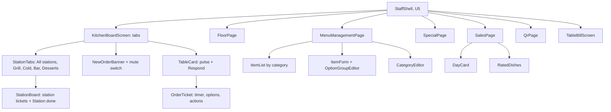

# Frontend Components: u7-staff-kitchen-features

The staff screens, their components and state, and the server routes behind them. Behaviour is in `functional-spec.md` (workflows W1 to W8) and the rules in `rules.md` (BR1.1 to BR10.3). It builds on U5's shared components (`src/client/components/ui/`), hooks (`useSoundPreference`, `useTheme`), alert logic (`src/client/alerts/`), the staff shell and page registry (`src/client/staff/`), `staffFetch` (which sends a refused request back to the PIN screen), and `useStaffSSE`. Only the QR page needs a new package, named in U7's code plan.

## Pages and Component Hierarchy

Text fallback: the staff shell hosts the pages. The Kitchen Board has the station tabs, the new-order banner with the mute switch, and table cards holding tickets; a station tab shows that station's tickets. Menu management has the item list, the item form with the option group editor, and the category editor. Past visits and sales has one card per day and the rated dishes.

## Components

| Component (file under `src/client/`) | Props | State it holds | Calls and listens to |
|---|---|---|---|
| `screens/staff/KitchenBoardScreen` (changed) | none | the selected tab, the table list, orders by table, open calls | `GET /api/staff/tables`; `GET /api/tables/{id}/orders?visit=current` per listed table; all staff events |
| `staff/board/StationTabs` | `selected`, `onSelect` | none | none |
| `staff/board/StationBoard` | `station` | the station's orders, loading, error | `GET /api/staff/stations/{station}/board`; `ORDER_PLACED`, `ORDER_STATUS_CHANGED`, `STATION_DONE`, `TABLE_CLOSED` |
| `components/staff/OrderCard` (changed) | `order`, `station?` | the ticket timer text | `POST /api/staff/orders/{n}/stations/{station}/done` on a station tab; v1's status route on All stations |
| `staff/board/TicketTimer` | `placedAt`, `completedAt?`, `status` | minutes shown, refreshed every 30 seconds | none; uses U5's `Timer` |
| `staff/board/NewOrderBanner` | `events` | banner shown or dismissed | U5's alert logic on `ORDER_PLACED`; `useSoundPreference` |
| `staff/board/CallPulse` | `calls`, `onRespond` | none | `POST /api/service-calls/{id}/respond` |
| `staff/pages/floor/index` FloorPage, `useFloorTables` | none | the tables with their state | `GET /api/staff/tables`; the six floor events |
| `staff/pages/menu/index` MenuManagementPage, `useStaffMenu` | none | the staff menu, loading, error | `GET /api/staff/menu`; `MENU_CHANGED` |
| `staff/pages/menu/ItemForm`, `OptionGroupEditor` | `item?`, `categories`, `onSaved`, `onCancel` | the typed values, field errors, saving | `POST` and `PATCH /api/staff/menu/items`, `PUT .../options` |
| `staff/pages/menu/CategoryEditor` | `categories` | the typed name, errors | `POST` and `PATCH /api/staff/menu/categories` |
| `staff/pages/special/index` SpecialPage | none | the live special, the launch form, errors | `GET /api/specials/current`, `POST /api/specials`, `DELETE /api/specials/current`; `SPECIAL_CHANGED` |
| `staff/pages/sales/index` SalesPage, `DayCard`, `RatedDishes` | none | days, ratings, loading, error | `GET /api/staff/sales`, `GET /api/staff/ratings?day=` |
| `staff/pages/qr/index` QrPage, `TableQr` | none | the table list, the page origin | `GET /api/staff/tables`; draws codes in the browser |
| `components/staff/BillOrderCard` (changed) | `order` | none | shows each line's options under the item |

## Server Modules (replace U5's stubs, `src/server/routes/`)

| Module | Routes | Notes |
|---|---|---|
| `staff-stations.ts` | `GET /api/staff/stations/{station}/board`, `POST /api/staff/orders/{n}/stations/{station}/done` | uses `transitionOrder`; publishes `STATION_DONE` and status events (BR1.1 to BR1.3) |
| `staff-menu.ts` | `GET /api/staff/menu`, `POST /api/staff/menu/items`, `PATCH /api/staff/menu/items/{id}`, `PUT /api/staff/menu/items/{id}/options`, `POST /api/staff/menu/categories`, `PATCH /api/staff/menu/categories/{id}` | validation BR5.2 to BR5.4; `publishMenuChange` after every write |
| `staff-floor.ts` | `GET /api/staff/tables` | floor state BR4.2 from the open visit, orders, open requests and `getPresence` |
| `staff-sales.ts` | `GET /api/staff/sales?from=&to=`, `GET /api/staff/ratings?day=` | BR7.1 to BR7.6, both timestamp formats, local day |
| `staff-qr.ts` | none new: the table list for the QR page comes from `GET /api/staff/tables`, and the codes are drawn in the browser | left exactly as U5 made it (U5's stub route `GET /api/staff/qr/{table}` is never called and its tests stay untouched) |

## Interaction Flows

1. **Station done:** the ticket's "<Station> done" sends the mark, the board re-reads from the `STATION_DONE` event, the ticket leaves that station's board and stays on All stations until the order completes.
2. **Menu edit:** the form validates nothing the server will not check again; the server's 400 puts the message beside the named field; a success closes the form and the list refreshes from `MENU_CHANGED`.
3. **Respond:** the pulse stops on the response event, not on the button press, so two staff devices stay in line.
4. **Refused request:** any 401 returns the screen to the PIN screen (U5's `staffFetch`); no page keeps typed data in that case except the menu form, which keeps its typed values for after a new sign-in.

## Form and Input Validation

| Input | Rule (the server decides; the form shows the message beside the field) |
|---|---|
| Item name | required, 1 to 60 characters |
| Description | at most 300 characters |
| Price | dollars with at most two decimals, sent as whole cents from 1 to 1,000,000 |
| Image | empty, a short emoji, or an http(s) address of at most 500 characters |
| Station | one of Grill, Cold, Bar, Desserts |
| Allergens | not set, or any of the nine |
| Option groups | at most 6 groups, 12 choices each, names up to 60 characters, a price change of -$1,000.00 to +$1,000.00, and the cheapest line never below zero |
| Category name | required, 1 to 60 characters, unique ignoring case |
| Special | an available item, a price of at least one cent, stock 1 to 999, minutes 1 to 720 |

## API Integration Points

| Call | Used by | On failure |
|---|---|---|
| `GET /api/staff/tables` | Board, Floor map, QR page | "The tables could not be loaded. Try again." with Retry |
| `GET /api/staff/stations/{station}/board` | Station tabs | v1's error view |
| `POST /api/staff/orders/{n}/stations/{station}/done` | Station done | a plain message on the ticket; 422 answers say why |
| `GET /api/staff/menu`, the menu writes | Menu management | "The menu could not be loaded. Try again." / the field message |
| `GET /api/staff/sales`, `GET /api/staff/ratings` | Sales | "Sales could not be loaded. Try again." |
| `POST /api/specials`, `DELETE /api/specials/current` (U5) | Special page | the field message |
| `POST /api/service-calls/{id}/respond` (U5) | Board | a plain message; the pulse stays |
| Staff events (`ORDER_PLACED`, `ORDER_STATUS_CHANGED`, `STATION_DONE`, `TABLE_CLOSED`, `MENU_CHANGED`, `SPECIAL_CHANGED`, `SERVICE_CALL_OPENED`, `SERVICE_CALL_RESPONDED`, `TABLE_PRESENCE_CHANGED`) | all pages | each screen reads its data again after a reconnect |

## Accessibility and Motion

Every control is at least 44 px and works from the keyboard; tabs use the tab pattern with arrow keys; the form shows each error beside its field and in a summary, announced to screen readers; "Slow", "Late", "Calling the waiter", "Needs the bill" and the other states appear as words with their colour; the pulse, the banner slide, the timer colour change and the theme change stop moving under reduced motion; the print view hides every button.
