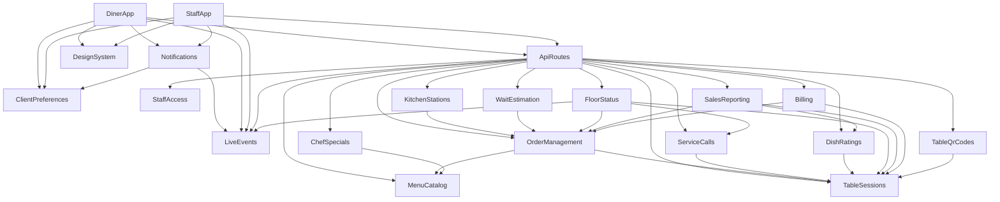

# Component Catalogue: Table Order v2

The logical building blocks of Table Order v2: the code to write or extend, built from the requirements (`inception/requirements-analysis/requirements.md`), the stories (`inception/user-stories/stories.md`) and the code knowledge base of v1 (`aidlc/spaces/default/codekb/table-order/architecture.md` and `component-inventory.md`). v1's layers are kept (menu, tables, orders, billing, live events, the API routes, the two client views), and a new building block is added for each new concern. Components marked **v1, extended** already exist and gain new behaviour; **new** components are added. Databases and the browser's storage are dependencies of components, not components. Deployment (one process, one SQLite file) stays as v1 has it and is decided in Units Generation. Entities are captured at the ownership and shape level only; full data definitions belong to Functional Design.

Answers from this stage: a dish's station is fixed on each order line when the order is placed (Q1), and "Browsing" counts open live connections for the table with a 5-minute quiet limit (Q2).

```yaml
components:
  - name: MenuCatalog
    summary: v1, extended. The menu: categories, items, options, allergens and stations.
    behaviour: >
      Owns what can be ordered. Items and categories can be added, edited and hidden by staff; a hidden item or category is not offered but stays in past orders.
      An item has option groups (choose one, choose any, leave out) whose choices carry a price change in whole cents, a list of allergens (from a fixed list of nine; no list means "Allergens not set") and one station (Grill, Cold, Bar, Desserts; no station counts as Grill).
      Validates name, price and image on every save. Sold-out toggling stays as v1.
    responsibilities:
      - Items, categories, option groups and choices, allergens and stations
      - Hide and show, edit and reorder
      - Availability (sold out) as in v1
    depends_on: []
    dependents:
      - component: ApiRoutes
        interaction: Serves the menu to diners and the edit actions to staff
      - component: OrderManagement
        interaction: Reads prices, options, availability and station when an order is placed
      - component: ChefSpecials
        interaction: A special is an existing item at a new price
    external_dependencies:
      - name: SQLite
        kind: database
        purpose: Stores the menu
    entities:
      - name: Category
        identifier: id
        attributes: [id, name, sort_order, hidden]
      - name: MenuItem
        identifier: id
        attributes: [id, category_id, name, description, price_cents, image, available, hidden, station, allergens]
        references:
          - entity: Category
            owned_by: MenuCatalog
            relationship: each MenuItem belongs to one Category
      - name: OptionGroup
        identifier: id
        attributes: [id, item_id, name, kind, required, sort_order]
        references:
          - entity: MenuItem
            owned_by: MenuCatalog
            relationship: each OptionGroup belongs to one MenuItem
      - name: OptionChoice
        identifier: id
        attributes: [id, group_id, label, price_delta_cents, sort_order]
        references:
          - entity: OptionGroup
            owned_by: MenuCatalog
            relationship: each OptionChoice belongs to one OptionGroup

  - name: TableSessions
    summary: v1, extended. The tables and each party's visit, from first order to Close table.
    behaviour: >
      Owns the list of tables and the visit model: a table with no open visit is closed, the next order opens a new visit, closing archives the visit and keeps its orders.
      New: provides the list of tables (so no screen hard-codes 10 tables) and closed visits by day for reporting.
    responsibilities:
      - Tables and visits
      - Open and close a visit
      - The table list
    depends_on: []
    dependents:
      - component: ApiRoutes
        interaction: Serves table status and the table list
      - component: OrderManagement
        interaction: Gets or opens the visit an order belongs to
      - component: ServiceCalls
        interaction: A call belongs to the open visit and clears when it closes
      - component: DishRatings
        interaction: A rating belongs to a closed visit
      - component: FloorStatus
        interaction: Reads which tables have an open visit
      - component: SalesReporting
        interaction: Reads closed visits by day
      - component: Billing
        interaction: Reads and closes the open visit
      - component: TableQrCodes
        interaction: Lists the tables to print codes for
    external_dependencies:
      - name: SQLite
        kind: database
        purpose: Stores tables and visits
    entities:
      - name: Table
        identifier: id
        attributes: [id, label]
      - name: Visit
        identifier: id
        attributes: [id, table_id, opened_at, closed_at]
        references:
          - entity: Table
            owned_by: TableSessions
            relationship: each Visit is for one Table

  - name: OrderManagement
    summary: v1, extended. Placing orders, their lines and options, and moving them through Pending, Preparing, Completed and Cancelled.
    behaviour: >
      Owns the order and its lifecycle rules (v1's legal transitions stay). On placement it freezes, per line, the price (item price plus chosen options), the chosen options and the station, so later menu edits never change an order already placed (Q1).
      Records the time an order became Completed, and the estimate shown at placement, so reports and "Running late" have something to read. Idempotent placement by placement key stays as v1.
      Order numbers stay global and sequential.
    responsibilities:
      - Place an order with options, frozen prices and stations
      - Status changes and their rules
      - Completed time and estimate at placement
    depends_on:
      - component: MenuCatalog
        interaction: Reads prices, options, availability and station for each line
        style: sync
      - component: TableSessions
        interaction: Gets or opens the visit for the order
        style: sync
    dependents:
      - component: ApiRoutes
        interaction: Runs the ordering use cases
      - component: KitchenStations
        interaction: Reads each order's lines by station and completes an order when every station is done
      - component: WaitEstimation
        interaction: Reads completed times and the open orders
      - component: FloorStatus
        interaction: Reads whether a table has orders Pending, Preparing or all Completed
      - component: SalesReporting
        interaction: Reads orders and lines of closed visits
      - component: Billing
        interaction: Reads the orders of the open visit
    external_dependencies:
      - name: SQLite
        kind: database
        purpose: Stores orders, lines and chosen options
    entities:
      - name: Order
        identifier: order_number
        attributes: [order_number, visit_id, table_id, status, placed_by, placement_key, placed_at, completed_at, estimate_minutes]
        references:
          - entity: Visit
            owned_by: TableSessions
            relationship: each Order belongs to one Visit
      - name: OrderLine
        identifier: id
        attributes: [id, order_number, item_id, quantity, unit_price_cents, station, special_id]
        references:
          - entity: Order
            owned_by: OrderManagement
            relationship: each OrderLine belongs to one Order
          - entity: MenuItem
            owned_by: MenuCatalog
            relationship: each OrderLine is for one MenuItem
      - name: OrderLineOption
        identifier: id
        attributes: [id, order_line_id, label, price_delta_cents]
        references:
          - entity: OrderLine
            owned_by: OrderManagement
            relationship: each OrderLineOption belongs to one OrderLine

  - name: KitchenStations
    summary: New. Which stations have finished their part of an order.
    behaviour: >
      The lines of an order by station are derived from the stations frozen on its order lines. This component owns only the "done" marks.
      When every station that has lines in an order is done, the order becomes Completed through OrderManagement. On the All stations view, Complete marks every remaining station done at once (v1 behaviour). An order with lines for one station behaves as in v1.
      Cancelling stays an order-level action.
    responsibilities:
      - Mark a station's part of an order done
      - Decide when an order is complete
      - Provide each station's board
    depends_on:
      - component: OrderManagement
        interaction: Reads order lines and sets the order Completed
        style: sync
    dependents:
      - component: ApiRoutes
        interaction: Serves the station boards and the done actions
    external_dependencies:
      - name: SQLite
        kind: database
        purpose: Stores the done marks
    entities:
      - name: StationDone
        identifier: id
        attributes: [id, order_number, station, done_at]
        references:
          - entity: Order
            owned_by: OrderManagement
            relationship: each StationDone is for one Order and one station

  - name: ChefSpecials
    summary: New. The one limited special with a countdown and a stock count.
    behaviour: >
      One special is live at a time. It is an existing menu item at a special price with a stock (1 to 999) and an end time in the future.
      Stock is reduced in the same database transaction that places the order, so the last one can never be sold twice; the loser of a race is told it is gone, using v1's dropped-line message.
      The special is removed when the stock reaches 0, the time passes or staff end it.
    responsibilities:
      - Launch and end a special
      - Reserve stock atomically with an order
      - Report whether a special is live
    depends_on:
      - component: MenuCatalog
        interaction: A special is an existing item
        style: sync
    dependents:
      - component: ApiRoutes
        interaction: Launches and ends specials, and reserves stock inside the order transaction
    external_dependencies:
      - name: SQLite
        kind: database
        purpose: Stores the special and its stock
    entities:
      - name: ChefSpecial
        identifier: id
        attributes: [id, item_id, special_price_cents, stock_total, stock_left, ends_at, ended_at]
        references:
          - entity: MenuItem
            owned_by: MenuCatalog
            relationship: each ChefSpecial is for one MenuItem

  - name: ServiceCalls
    summary: New. "Call the waiter" and "Ask for the bill" requests from a table.
    behaviour: >
      A table has at most one open request of each kind, so pressing again creates nothing new. Staff respond to clear one; closing the table clears the rest.
    responsibilities:
      - Open a request, once per kind per visit
      - Respond to a request
      - Clear requests when the table closes
    depends_on:
      - component: TableSessions
        interaction: A request belongs to the table's open visit
        style: sync
    dependents:
      - component: ApiRoutes
        interaction: Opens and responds to requests
      - component: FloorStatus
        interaction: Reads whether a table has asked for the bill
    external_dependencies:
      - name: SQLite
        kind: database
        purpose: Stores requests
    entities:
      - name: ServiceCall
        identifier: id
        attributes: [id, visit_id, table_id, kind, opened_at, responded_at]
        references:
          - entity: Visit
            owned_by: TableSessions
            relationship: each ServiceCall belongs to one Visit

  - name: DishRatings
    summary: New. One thumbs up or down per dish per table visit, and the best and worst of the day.
    behaviour: >
      A rating belongs to a closed visit and one dish; there is at most one per dish per visit, and it can be changed until the diner presses Done. Ranks dishes by share of thumbs up with a stated tie rule, and shows how many ratings each has; a dish with no ratings is not ranked.
    responsibilities:
      - Record and change a rating
      - Rank the best and worst rated dishes for a day
    depends_on:
      - component: TableSessions
        interaction: A rating belongs to a closed visit
        style: sync
    dependents:
      - component: ApiRoutes
        interaction: Takes ratings from diners and serves the summary to staff
      - component: SalesReporting
        interaction: Includes the day's best and worst rated dishes
    external_dependencies:
      - name: SQLite
        kind: database
        purpose: Stores ratings
    entities:
      - name: DishRating
        identifier: id
        attributes: [id, visit_id, item_id, thumb, rated_at]
        references:
          - entity: Visit
            owned_by: TableSessions
            relationship: each DishRating belongs to one Visit
          - entity: MenuItem
            owned_by: MenuCatalog
            relationship: each DishRating is for one MenuItem

  - name: StaffAccess
    summary: New. The Staff PIN, staff sessions and the lockout.
    behaviour: >
      Reads the PIN from the environment (or makes a random 4-digit one at start and prints it once). A correct PIN opens a staff session held in server memory until the browser closes or staff sign out; a restart signs everyone out.
      Counts wrong tries by client address plus session on the server; 5 in a row lock that client for 60 seconds, and the count is in memory, so a restart clears it. No PIN is stored in code or written to logs.
    responsibilities:
      - Check the PIN, open and end sessions
      - Lock out after repeated wrong tries
      - Answer whether a request is a staff request
    depends_on: []
    dependents:
      - component: ApiRoutes
        interaction: Guards every staff route and the staff live stream, and tells a staff status change from a diner cancel
    external_dependencies: []
    entities:
      - name: StaffSession
        identifier: token
        attributes: [token, created_at]
      - name: LoginAttempt
        identifier: client_key
        attributes: [client_key, failures, locked_until]

  - name: WaitEstimation
    summary: New. The estimated wait, worked out from how long today's orders took and how busy the kitchen is.
    behaviour: >
      Derived; owns no data. The estimate is the average of today's placed-to-Completed times plus an allowance for each open order ahead; with none completed today it starts at a fixed value and is labelled as an estimate. Orders from before v2 have no Completed time and are left out.
    responsibilities:
      - Work out the estimate for a new order and for an open order
    depends_on:
      - component: OrderManagement
        interaction: Reads today's completed times and the open orders
        style: sync
    dependents:
      - component: ApiRoutes
        interaction: Serves the estimate and records it on the order at placement
    external_dependencies: []
    entities: []

  - name: FloorStatus
    summary: New. The state of every table for the floor map.
    behaviour: >
      Derived; owns no data. A table is Needs the bill, Waiting, Eating, Browsing or Empty, chosen in that order of precedence. Browsing means at least one diner page for the table has an open live connection, not quiet for more than 5 minutes, and the table has no order (Q2).
    responsibilities:
      - Combine visits, orders, calls and open connections into one state per table
    depends_on:
      - component: TableSessions
        interaction: Which tables have an open visit
        style: sync
      - component: OrderManagement
        interaction: Whether orders are Pending, Preparing or all Completed
        style: sync
      - component: ServiceCalls
        interaction: Whether the bill was asked for
        style: sync
      - component: LiveEvents
        interaction: How many diner pages are connected for a table
        style: sync
    dependents:
      - component: ApiRoutes
        interaction: Serves the floor map
    external_dependencies: []
    entities: []

  - name: SalesReporting
    summary: New. Closed visits by day with totals, best sellers and average time to Completed.
    behaviour: >
      Derived; owns no data. Days run midnight to midnight in the server's local time; both timestamp formats v1 stores are read. Cancelled orders are left out. A day with no completed orders shows "No completed orders", not 0.
    responsibilities:
      - Day totals, visits, orders, best sellers, average time
    depends_on:
      - component: TableSessions
        interaction: Closed visits by day
        style: sync
      - component: OrderManagement
        interaction: Orders and lines of those visits
        style: sync
      - component: DishRatings
        interaction: Best and worst rated dishes of the day
        style: sync
    dependents:
      - component: ApiRoutes
        interaction: Serves the sales page
    external_dependencies: []
    entities: []

  - name: Billing
    summary: v1, extended. The bill of the open visit and Close table.
    behaviour: >
      Unchanged rules: the bill lists non-cancelled orders and a combined total, and Close table works only when the visit has orders and none is Pending or Preparing. New: option lines show under their item, and closing the table clears open service calls (through ApiRoutes).
    responsibilities:
      - Build the bill
      - Close a table
    depends_on:
      - component: TableSessions
        interaction: Reads and closes the open visit
        style: sync
      - component: OrderManagement
        interaction: Reads the visit's orders
        style: sync
    dependents:
      - component: ApiRoutes
        interaction: Serves the bill and Close table
    external_dependencies: []
    entities: []

  - name: TableQrCodes
    summary: New. A printable QR code for every table.
    behaviour: >
      Derived; owns no data. Builds the address for each table from the address the page was opened on followed by /table/ and the table's number, and makes the codes inside the app with no outside service.
    responsibilities:
      - Make a code for each table
    depends_on:
      - component: TableSessions
        interaction: Lists the tables
        style: sync
    dependents:
      - component: ApiRoutes
        interaction: Serves the table list for the QR page
    external_dependencies: []
    entities: []

  - name: LiveEvents
    summary: v1, extended. The live event streams (staff and per table) and their connections.
    behaviour: >
      Unchanged: in-memory channels with a replay buffer, keep-alive and reconnect replay. New: more event types (menu changes, specials, calls, station progress, estimates), a count of open connections per table with the time each last showed activity, and the staff stream is guarded by the staff session.
    responsibilities:
      - Publish and replay events
      - Track open connections per table
    depends_on: []
    dependents:
      - component: ApiRoutes
        interaction: Publishes events after writes and opens the streams
      - component: FloorStatus
        interaction: Reads open connections per table
      - component: Notifications
        interaction: Delivers the events that raise alerts
      - component: DinerApp
        interaction: Delivers live changes to the diner screens
      - component: StaffApp
        interaction: Delivers live changes to the staff screens
    external_dependencies: []
    entities: []

  - name: ApiRoutes
    summary: v1, extended. The server's routes: validation, the staff guard, and the use cases that span components.
    behaviour: >
      Validates input at the boundary and maps errors to the v1 error shape. Every staff route and the staff stream check the staff session (401 UNAUTHORIZED without one); diner routes stay open. Runs the cross-component use cases so components never call each other sideways: placing an order (reserve a special's stock, place, record the estimate, publish), closing a table (close, clear calls, publish), station done (mark, complete the order, publish). New routes are mounted before the page catch-all and the page route serves index.html with a root setting.
    responsibilities:
      - HTTP routes and live-stream routes
      - Staff guard on every staff route
      - Orchestrate use cases across components
    depends_on:
      - component: MenuCatalog
        interaction: Menu reads and staff edits
        style: sync
      - component: TableSessions
        interaction: Table status and the table list
        style: sync
      - component: OrderManagement
        interaction: Place orders and change status
        style: sync
      - component: KitchenStations
        interaction: Station boards and done actions
        style: sync
      - component: ChefSpecials
        interaction: Specials and stock
        style: sync
      - component: ServiceCalls
        interaction: Calls and responses
        style: sync
      - component: DishRatings
        interaction: Ratings and the summary
        style: sync
      - component: StaffAccess
        interaction: PIN check and the staff guard
        style: sync
      - component: WaitEstimation
        interaction: The estimate
        style: sync
      - component: FloorStatus
        interaction: The floor map
        style: sync
      - component: SalesReporting
        interaction: The sales page
        style: sync
      - component: Billing
        interaction: Bill and Close table
        style: sync
      - component: TableQrCodes
        interaction: The QR page
        style: sync
      - component: LiveEvents
        interaction: Publishes events and opens streams
        style: event
    dependents:
      - component: DinerApp
        interaction: Calls the diner routes
      - component: StaffApp
        interaction: Calls the staff routes
    external_dependencies: []
    entities: []

  - name: ClientPreferences
    summary: New. What a person sets once in their own browser: theme, sound and allergies.
    behaviour: >
      Kept in the browser, never on the server. The theme is Follow device, Light or Dark; sound is On or Muted; allergies come from the fixed list of nine. Each survives a reload; storage that is blocked falls back to the defaults without an error.
    responsibilities:
      - Save and read the theme, sound and allergies
    depends_on: []
    dependents:
      - component: Notifications
        interaction: Reads the sound setting
      - component: DinerApp
        interaction: Reads the allergies and theme
      - component: StaffApp
        interaction: Reads the theme and sound
    external_dependencies:
      - name: Browser storage
        kind: other
        purpose: Remembers the choices in that browser
    entities:
      - name: ThemePreference
        identifier: storage_key
        attributes: [storage_key, mode]
      - name: SoundPreference
        identifier: storage_key
        attributes: [storage_key, muted]
      - name: AllergyProfile
        identifier: storage_key
        attributes: [storage_key, allergens]

  - name: DesignSystem
    summary: New. The tokens, both themes and the shared components every screen uses.
    behaviour: >
      Colours in a dark theme (v1's palette) and a light theme, a type scale, a spacing scale, radius, shadows and the shared components (buttons, pills, chips, badges, timers, banners, sheets, tab bar, side navigation, tracker, forms). v1 token names stay as aliases until every component has moved over. All motion stops for reduced motion.
    responsibilities:
      - Tokens and themes
      - Shared components
    depends_on: []
    dependents:
      - component: DinerApp
        interaction: Styles every diner screen
      - component: StaffApp
        interaction: Styles every staff screen
    external_dependencies: []
    entities: []

  - name: Notifications
    summary: New. The alerts that tell a diner an order is ready and staff a new order has arrived.
    behaviour: >
      Raises a banner, a short sound unless muted and a short vibration where supported. An alert fires once per event: nothing repeats after a reconnect or a page reload for events that already happened. Sound and vibration wait for the person's first tap on the page.
    responsibilities:
      - Raise and dismiss alerts
      - Avoid repeats
    depends_on:
      - component: LiveEvents
        interaction: Receives order events
        style: event
      - component: ClientPreferences
        interaction: Reads the sound setting
        style: sync
    dependents:
      - component: DinerApp
        interaction: Shows the ready banner
      - component: StaffApp
        interaction: Shows the new-order alert
    external_dependencies: []
    entities: []

  - name: DinerApp
    summary: v1, extended. The diner's Menu, Cart and My orders, Settings and the closed-table rating.
    behaviour: >
      Keeps the bottom tab bar with the Cart count, "View cart" and "Place order" above it, sticky category pills and the "+ Add" pill. New: the options sheet, allergy marks and the allergy warning, estimate and tracker, "Same again", the call card, the Chef's special card, Settings, and Rate your meal. The cart lives in the browser, with each line's chosen options.
    responsibilities:
      - Diner screens and their states
      - The cart and its refresh rules
    depends_on:
      - component: ApiRoutes
        interaction: Calls the diner routes
        style: sync
      - component: LiveEvents
        interaction: Receives live changes for the table
        style: event
      - component: ClientPreferences
        interaction: Reads allergies and theme
        style: sync
      - component: DesignSystem
        interaction: Styles the screens
        style: sync
      - component: Notifications
        interaction: Shows the ready banner
        style: sync
    dependents: []
    external_dependencies:
      - name: Browser storage
        kind: other
        purpose: Keeps the cart and its placement key
    entities:
      - name: Cart
        identifier: table_id
        attributes: [table_id, placement_key, lines]
      - name: CartLine
        identifier: line_key
        attributes: [line_key, item_id, quantity, option_choice_ids]
        references:
          - entity: MenuItem
            owned_by: MenuCatalog
            relationship: each CartLine is for one MenuItem

  - name: StaffApp
    summary: v1, extended. The staff screens behind the PIN: Kitchen Board and stations, bill, floor map, menu management, specials, sales and QR codes.
    behaviour: >
      Shows only the PIN screen until a staff session exists, then the side navigation (top bar and menu button on narrow screens) and the staff pages. Keeps v1's board cards, buttons and bill rules. New: station tabs, ticket timers, the new-order alert, the call pulse, and the new pages.
    responsibilities:
      - Staff screens and their states
      - The PIN screen and sign out
    depends_on:
      - component: ApiRoutes
        interaction: Calls the staff routes
        style: sync
      - component: LiveEvents
        interaction: Receives live changes for all tables
        style: event
      - component: ClientPreferences
        interaction: Reads the theme and sound
        style: sync
      - component: DesignSystem
        interaction: Styles the screens
        style: sync
      - component: Notifications
        interaction: Shows the new-order alert
        style: sync
    dependents: []
    external_dependencies: []
    entities: []
```

## Component Diagram



Text fallback: the two client views (DinerApp, StaffApp) call ApiRoutes and listen to LiveEvents, and share DesignSystem, ClientPreferences and Notifications. ApiRoutes is the only caller of the server components, so they never call each other sideways except for plain reads downward: OrderManagement reads MenuCatalog and TableSessions; KitchenStations reads OrderManagement; ChefSpecials reads MenuCatalog; ServiceCalls and DishRatings read TableSessions; the derived components (WaitEstimation, FloorStatus, SalesReporting, Billing, TableQrCodes) read the components that own the data. There are no cycles.

## Component Summary

| Component | Purpose | Depends On | Dependents | Entities Owned |
|---|---|---|---|---|
| MenuCatalog (v1, extended) | The menu, options, allergens, stations | none | ApiRoutes, OrderManagement, ChefSpecials | Category, MenuItem, OptionGroup, OptionChoice |
| TableSessions (v1, extended) | Tables and visits | none | ApiRoutes, OrderManagement, ServiceCalls, DishRatings, FloorStatus, SalesReporting, Billing, TableQrCodes | Table, Visit |
| OrderManagement (v1, extended) | Orders and their lifecycle | MenuCatalog, TableSessions | ApiRoutes, KitchenStations, WaitEstimation, FloorStatus, SalesReporting, Billing | Order, OrderLine, OrderLineOption |
| KitchenStations (new) | Station progress | OrderManagement | ApiRoutes | StationDone |
| ChefSpecials (new) | The limited special | MenuCatalog | ApiRoutes | ChefSpecial |
| ServiceCalls (new) | Waiter and bill requests | TableSessions | ApiRoutes, FloorStatus | ServiceCall |
| DishRatings (new) | Thumbs per dish | TableSessions | ApiRoutes, SalesReporting | DishRating |
| StaffAccess (new) | PIN and sessions | none | ApiRoutes | StaffSession, LoginAttempt |
| WaitEstimation (new) | The estimate | OrderManagement | ApiRoutes | none |
| FloorStatus (new) | Table states | TableSessions, OrderManagement, ServiceCalls, LiveEvents | ApiRoutes | none |
| SalesReporting (new) | Sales by day | TableSessions, OrderManagement, DishRatings | ApiRoutes | none |
| Billing (v1, extended) | Bill and Close table | TableSessions, OrderManagement | ApiRoutes | none |
| TableQrCodes (new) | QR codes | TableSessions | ApiRoutes | none |
| LiveEvents (v1, extended) | Live streams | none | ApiRoutes, FloorStatus, Notifications, DinerApp, StaffApp | none |
| ApiRoutes (v1, extended) | Routes, staff guard, use cases | 14 server components | DinerApp, StaffApp | none |
| ClientPreferences (new) | Theme, sound, allergies | none | Notifications, DinerApp, StaffApp | ThemePreference, SoundPreference, AllergyProfile |
| DesignSystem (new) | Tokens and components | none | DinerApp, StaffApp | none |
| Notifications (new) | Ready and new-order alerts | LiveEvents, ClientPreferences | DinerApp, StaffApp | none |
| DinerApp (v1, extended) | Diner screens | ApiRoutes, LiveEvents, ClientPreferences, DesignSystem, Notifications | none | Cart, CartLine |
| StaffApp (v1, extended) | Staff screens | ApiRoutes, LiveEvents, ClientPreferences, DesignSystem, Notifications | none | none |

## Entity Ownership

| Entity | Owning Component | Identifier | Attributes | References |
|---|---|---|---|---|
| Category | MenuCatalog | id | id, name, sort_order, hidden | none |
| MenuItem | MenuCatalog | id | id, category_id, name, description, price_cents, image, available, hidden, station, allergens | Category |
| OptionGroup | MenuCatalog | id | id, item_id, name, kind, required, sort_order | MenuItem |
| OptionChoice | MenuCatalog | id | id, group_id, label, price_delta_cents, sort_order | OptionGroup |
| Table | TableSessions | id | id, label | none |
| Visit | TableSessions | id | id, table_id, opened_at, closed_at | Table |
| Order | OrderManagement | order_number | order_number, visit_id, table_id, status, placed_by, placement_key, placed_at, completed_at, estimate_minutes | Visit |
| OrderLine | OrderManagement | id | id, order_number, item_id, quantity, unit_price_cents, station, special_id | Order, MenuItem |
| OrderLineOption | OrderManagement | id | id, order_line_id, label, price_delta_cents | OrderLine |
| StationDone | KitchenStations | id | id, order_number, station, done_at | Order |
| ChefSpecial | ChefSpecials | id | id, item_id, special_price_cents, stock_total, stock_left, ends_at, ended_at | MenuItem |
| ServiceCall | ServiceCalls | id | id, visit_id, table_id, kind, opened_at, responded_at | Visit |
| DishRating | DishRatings | id | id, visit_id, item_id, thumb, rated_at | Visit, MenuItem |
| StaffSession | StaffAccess | token | token, created_at | none |
| LoginAttempt | StaffAccess | client_key | client_key, failures, locked_until | none |
| ThemePreference | ClientPreferences | storage_key | storage_key, mode | none |
| SoundPreference | ClientPreferences | storage_key | storage_key, muted | none |
| AllergyProfile | ClientPreferences | storage_key | storage_key, allergens | none |
| Cart | DinerApp | table_id | table_id, placement_key, lines | none |
| CartLine | DinerApp | line_key | line_key, item_id, quantity, option_choice_ids | MenuItem |

## External Dependencies

| Component | Dependency | Kind | Purpose |
|---|---|---|---|
| MenuCatalog, TableSessions, OrderManagement, KitchenStations, ChefSpecials, ServiceCalls, DishRatings | SQLite | database | One database file (from `DB_FILE`); changes only add tables or columns with defaults |
| ClientPreferences, DinerApp | Browser storage | other | Remembers preferences and the cart in that browser |

## Rationale

| Component | Why it is a separate building block |
|---|---|
| MenuCatalog | Distinct data (what can be ordered) with its own staff editing and its own change rate |
| TableSessions | Distinct lifecycle: a visit opens with the first order and ends at Close table |
| OrderManagement | The core lifecycle and freezing rules; everything else reads it |
| KitchenStations | A distinct concern (station progress) that changes when an order is Completed, kept apart so v1's order rules stay simple |
| ChefSpecials | Distinct data with a clock and a stock that must be updated atomically |
| ServiceCalls | Distinct lifecycle: opened by a diner, answered by staff, cleared at close |
| DishRatings | Distinct lifecycle: only after a visit is closed |
| StaffAccess | A security concern with its own state (sessions, lockout) that must not be mixed with business data |
| WaitEstimation, FloorStatus, SalesReporting | Distinct read-only concerns that own no data, so they can change without touching the data owners |
| Billing | Kept from v1: its own rules and screen |
| TableQrCodes | A small, separate concern with no data of its own |
| LiveEvents | Kept from v1: the one place that knows about connections |
| ApiRoutes | One place where staff are checked and where use cases that span components run, so components never call each other sideways |
| ClientPreferences, DesignSystem, Notifications | Shared by both client views, with different lifecycles (browser storage, build-time tokens, event-driven alerts) |
| DinerApp, StaffApp | The two audiences, as in v1 |

Alternatives rejected for the whole decomposition are in `decisions.md` (ADR-001 and ADR-002).

## Assumptions & Open Questions

- The component split is a proposal for Units Generation to group; deployment stays one process and one SQLite file, as in v1.
- Full data definitions (types, allowed values, cardinality, the exact tables and columns to add) are for Functional Design.
- The estimate allowance per open order, the colours of the light theme and the exact event names are decided in Functional Design and Contract Design.
