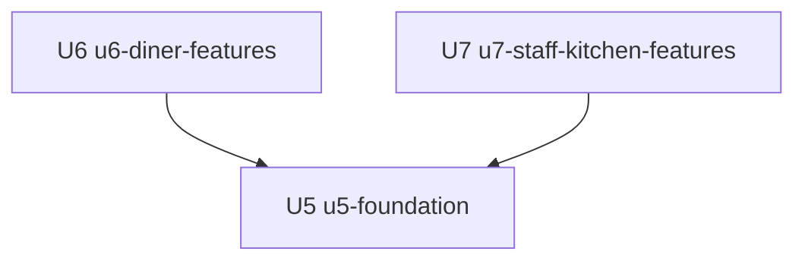

# Unit Dependencies: Table Order v2

The dependency graph (topology only) between the three v2 Units, from the component catalogue (`inception/domain-design/components.md`) and the Units in `unit-of-work.md`. Which Unit to build first, and why, is decided in Delivery Planning.

## Dependency Graph

- **U5 `u5-foundation`** depends on no other v2 Unit. It builds on v1 as it stands.
- **U6 `u6-diner-features`** depends on **U5**. It needs U5's code and tests (the new look, the order and menu changes, the engines and routes, the live events), and on v1.
- **U7 `u7-staff-kitchen-features`** depends on **U5**. It needs the same, and on v1.
- There is **no edge between U6 and U7**: each uses only v1 and U5.



Text fallback: U6 depends on U5, and U7 depends on U5. Neither depends on the other. The graph has no cycles.

```yaml
units:
  - name: u5-foundation
    kind: service
    depends_on: []
  - name: u6-diner-features
    kind: ui
    depends_on: [u5-foundation]
  - name: u7-staff-kitchen-features
    kind: ui
    depends_on: [u5-foundation]
```

## Integration Points

| Between | What crosses | How |
|---|---|---|
| U6 and U5 | Menu with options, allergens and stations; the estimate; specials; call and rating routes; order placement with options; the new live events; the design system and shared alert logic | The routes and events U5 provides, and U5's shared files |
| U7 and U5 | The staff session and guard; the staff shell and registered pages; the new data (stations, specials, calls, ratings, Completed time); the new live events; the design system | The routes and events U5 provides, and U5's shared files |
| U6 and U7 | Nothing in code. They meet only through the database and live events that U5 defines: a special launched in U7 appears in U6's Menu; a call raised in U6 pulses in U7's board; a rating given in U6 appears in U7's summary; an order placed in U6 shows in U7's board | The contracts pinned in Contract Design |
| Both and v1 | v1's tables, routes, hooks, screens and tests | Extended only as the "Changes to v1" list allows |

## Parallel Development Opportunities

- U6 and U7 have no dependency between them, so they can be built at the same time, each in its own copy of the project with only v1 and U5's work in it. Each Unit's code and tests must pass with its own code, U5, and the project as it stands.
- Both are blocked until U5 is built, because both depend on it.
- Two valid orderings exist: U5, U6, U7 and U5, U7, U6.

## Shared Files and How They Are Kept Apart

U6 and U7 are built apart and merged, so they must not change the same lines. U5 provides these seams:
- A single list that mounts one server route module per feature, with a module for each U6 and U7 feature added by U5 as an empty stub that its owner fills in.
- A single list that registers one page file per staff page (U7), and one file per diner feature area (U6).
- Shared client hooks for the live events are registered once by U5, including every new event type, so neither feature Unit edits the event lists.
- The design system's files are U5's; a feature Unit adds a component to its own feature folder rather than to the shared one.

## Contracts to Pin in Contract Design

The contracts between U5 and each feature Unit, and the contracts U6 and U7 meet through: the new and extended routes, the new live events and their payloads, the new tables and columns, the staff session, and the shape of an order line with its options and station.

## Assumptions & Open Questions

- U5 will take the longest. Splitting it further is possible but would make some Unit depend on an earlier part of U5, so it is not proposed here.
- If a story is found to need both U6 and U7, a U8 is added after they have merged rather than adding an edge between them.
