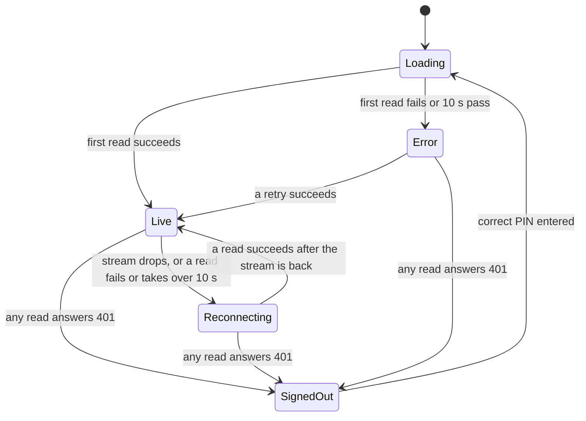
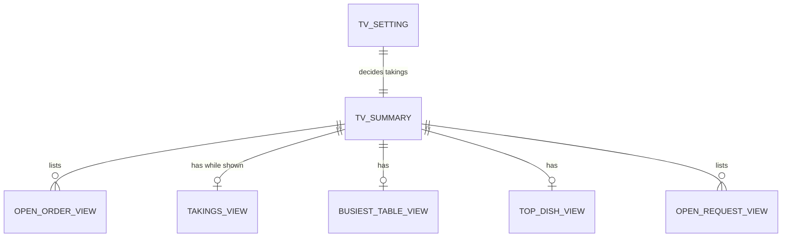

# Functional Specification — U8 `u8-tv-foundation`

U8 is the walking skeleton of the Manager TV wall: the smallest slice that works end to end. It runs from the new setting table, through the summary read, to a plain full-screen page that updates live, and adds the switch in the staff navigation.

Sources:
- **Unit definition:** `inception/units-generation/unit-of-work.md`.
- **Stories:** U8 implements all of US1.1–US5.3 from `inception/user-stories/stories.md` (story map: `inception/units-generation/unit-of-work-story-map.md`). The finished look of US1.1, US2.x, US3.x, US4.1, US5.1 and US5.3 is U9's.
- **Requirements:** `inception/requirements-analysis/requirements.md`.
- **Components:** `inception/domain-design/components.md`.
- **Contracts:** C1–C5 in `inception/contract-design/contract-summary.md`.

Data shapes are defined in `entities.md` and the rules in `rules.md`. This file is the source of truth for the workflows and state machines.

## Workflows

### W1 — Read the TV wall summary (GET /api/staff/tv/summary)

1. The existing staff guard checks the session. With no session it answers 401 and stops (BR6.1). With a session it refreshes the idle time (BR6.2).
2. Read the setting (BR1.1).
3. Work out `server_time`, now, and `day`, the server-local day of now.
4. Open orders: read every Pending or Preparing order across all tables with its portions, ordered as BR2.1 says (`getOpenOrdersAllTables`).
5. Busiest table: read today's order counts per table (`getTodayOrderCountsByTable(day)`, BR3.4 window, BR4.1).
6. Top dish: read today's portions per item (`getTodayPortionsByItem(day)`, BR3.4 window, BR4.2).
7. Requests: read every open request (`listOpenCallsAllTables`, BR5.1).
8. Takings, only if the setting is on: `closed_cents = closedDayTakingsCents(day)` (BR3.1) and `open_cents = openVisitsBillTotalCents()` (BR3.2). If the setting is off, leave `takings` out (BR3.3).
9. Answer 200 with the summary.

Error path: any read that fails makes the route answer 500 INTERNAL_ERROR and log the failure with its place. Nothing partial is sent.

### W2 — Change the setting (PUT /api/staff/tv/settings)

1. The staff guard checks the session (BR6.1).
2. Validate the body (BR1.2). An invalid body gets 400 INVALID_REQUEST.
3. If the value is unchanged, answer 200 with the current setting. Nothing is saved or published (BR1.3).
4. Otherwise save `value` and `updated_at = now`.
5. After the save succeeds, publish TV_SETTINGS_CHANGED `{ show_takings, updated_at }` on the staff channel (BR1.3).
6. Answer 200 with the new setting.

Error path: a failed save answers 500, is logged, and publishes nothing.

### W3 — Read the setting (GET /api/staff/tv/settings)

1. The staff guard checks the session (BR6.1).
2. Answer 200 with `{ show_takings, updated_at }`. With no row the answer is `{ show_takings: false, updated_at: null }` (BR1.1).

### W4 — The TV page stays current (`useTvWall()`, C4)

1. On mount, request a read (W1).
2. Subscribe through the shared staff live stream (`useStaffSSE`). Every event BR7.1 lists, and every reconnect, requests a read.
3. Requests are merged: at most one read in flight and one waiting (BR7.2). A newer answer always wins (BR7.5).
4. Every 15 seconds, recompute `now` (server_time plus the time since that summary arrived) and every wait and label (BR7.7, BR2.3, BR2.4). When `now` passes midnight of `summary.day`, request a read (BR7.4).
5. Five minutes after the last read started, request a read (BR7.3).
6. A 401 hands the page to the PIN screen through the existing `staffFetch` behaviour (BR6.3).
7. A failure, or no answer within 10 s, keeps the last summary and moves to Reconnecting. With no summary yet it moves to Error. Either way it retries every 10 s (BR7.6).

### W5 — The switch stays true (`TvTakingsSwitch`)

1. On mount and on every staff-stream reconnect, read the setting (W3, BR8.1).
2. On TV_SETTINGS_CHANGED, set the position from the event (BR8.1).
3. On click, Space or Enter, show the new position at once and send W2. On failure, return to the old position and show the existing "Server did not answer, Try again" message (BR8.2).

### W6 — Move the Sales rule safely (once, during the build)

1. First write the regression test that captures `getSales()` output for a fixed dataset (BR10.1).
2. Move the closed-day money rule into `src/server/salesRules.ts` as `closedDayTakingsCents(day)`, with the BR3.4 day window.
3. Make `getSales` use the shared day rule. Its output must not change: the regression test passes unchanged.
4. Add the test that the TV's `closed_cents` equals `getSales()` `total_cents` for today. Its data has one table closed today, one closed yesterday, and visits in both stored time formats near midnight (AC3.1.2).

## State Machines

### TV page connection state

<!-- Text fallback: The page starts Loading. A first good read makes it Live; a failed first read makes it Error, which retries until Live. From Live a dropped stream or failed read gives Reconnecting, which returns to Live on the next good read. Any 401 sends the page to SignedOut (the PIN screen); a correct PIN starts Loading again. -->

| State | Shows | Leaves when |
|---|---|---|
| Loading | Title and an empty layout, no numbers | The first read succeeds (Live) or fails (Error) |
| Live | The summary; the header says "Live" | The stream drops or a read fails (Reconnecting), or a read gets 401 (SignedOut) |
| Reconnecting | The last summary; the header says "Reconnecting… last update HH:MM" | A read succeeds (Live) |
| Error | "Can't reach the restaurant server. Trying again…" | A retry succeeds (Live) |
| SignedOut | The staff PIN screen | The correct PIN is entered (Loading) |

### Show-takings setting

| State | Event | Guard | Next | Action |
|---|---|---|---|---|
| Hidden (default, also when there is no row) | PUT true | Staff session | Shown | Save, then publish TV_SETTINGS_CHANGED |
| Shown | PUT false | Staff session | Hidden | Save, then publish TV_SETTINGS_CHANGED |
| Hidden or Shown | PUT with the same value | Staff session | Unchanged | Nothing saved or published |
| Either | PUT without a session or with an invalid body | — | Unchanged | 401 or 400 |

## Entity-Relationship View (derived from `entities.md`)

<!-- Text fallback: one TV summary lists any number of open orders and open requests, and has at most one takings part (only while shown), one busiest table and one top dish. The stored TV setting decides whether the takings part is present. -->

## Rules Summary (derived from `rules.md`)

- **Hidden by default:** takings start hidden and only a staff member can change that. A change is saved, then announced; the same value again announces nothing.
- **Open orders:** every open order from any day, oldest first, sized in portions, timed on the server's clock, labelled Slow from 8 and Late from 15 minutes.
- **Money:** the same total as the Sales page, plus the money on open tables. Nothing about money is sent while hidden. One day rule works for both stored time formats.
- **Busiest table and top dish:** today only, with set tie-breaks and empty wording.
- **Access:** the existing staff guard protects the data and keeps the TV signed in. A restart asks for the PIN once.
- **Staying current:** the TV re-reads on events, on reconnect, every 5 minutes and at midnight. Bursts are merged and the latest answer wins.
- **Switch:** re-reads the setting on load and on reconnect, and returns to its old position if a save fails.
- **Protecting v1 and v2:** the Sales page is guarded by a regression test written before the move, and changed tests are listed.

## The Plain TV Page (U8 only)

U8's page at `/staff/tv` is deliberately plain. It uses the existing design tokens and shows:
- the title;
- "Live" or "Reconnecting… last update HH:MM";
- a simple list of open orders (table, order number, portions, minutes, Slow/Late word);
- "No open orders" when the list is empty;
- the oldest wait;
- "Today's takings" and "On open tables", or "Takings hidden";
- the busiest table or "No orders yet";
- the top dish or "No dishes yet";
- the open requests.

U9 replaces its look with the mockups and keeps `useTvWall()` and the route as they are.

## Changes to v1 and v2 Made by U8

| File | Change | Why |
|---|---|---|
| `src/server/db.ts` | New upgrade step `tv-settings` | BR1.4 |
| `src/server/routes/u7/sales.ts` | `getSales` uses the shared day rule from `src/server/salesRules.ts`; output unchanged | BR3.1, BR10.1 |
| `src/server/repositories/orderRepo.ts`, `serviceCallRepo.ts`, `billingRepo.ts` | New read functions only (C5); existing functions unchanged | W1 |
| `src/server/routes/registry.ts` | New `staff-tv` entry after `staff`; the `owner` type gains `'U8'` | BR6.1 |
| `src/client/hooks/eventNames.ts` | `STAFF_EVENT_NAMES` gains `TV_SETTINGS_CHANGED` | BR7.1, BR8.1 |
| `src/client/staff/pages/registry.tsx`, `StaffShell.tsx` | New `tv` entry with `fullScreen`; the shell skips its navigation for full-screen pages and renders the switch under the TV wall link | BR9.1, BR9.2 |

## Tests U8 Adds

- **Server:**
  - BR1.1–BR1.4: setting default, staff-only, validation, no event on an unchanged value.
  - BR2.1–BR2.2: open orders from any day and their ordering.
  - BR3.1–BR3.4: TV total equals the Sales total; open-table money; no takings key while hidden; both time formats near midnight.
  - BR4.1–BR4.2: busiest table and top dish, with their tie-breaks.
  - BR5.1: open requests.
  - BR6.1: 401 without a session.
  - BR10.1: Sales regression.
  - NFR6: with 10,000 past closed visits, the summary answers in under 300 ms in the test environment.
- **Client unit:**
  - waits and labels at 7, 8, 14 and 15 minutes (BR2.3–BR2.4);
  - burst merging and latest-wins (BR7.2, BR7.5);
  - the midnight trigger (BR7.4);
  - switch sync and revert (BR8.1–BR8.2).
- **Browser (`e2e/u8-tv-foundation/`):**
  - the link opens a full-screen page;
  - the PIN gate on `/staff/tv`;
  - an order placed by a diner appears within 2 s;
  - flipping the switch shows and hides the amounts on an open TV;
  - a second staff page's switch follows;
  - `mockup-match.spec.ts` for `staff-nav-switch.html`. The four TV wall mockups are U9's and are left out.
