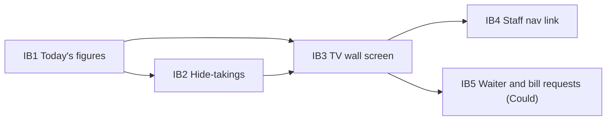

# Intent Backlog — Manager TV Wall

Prioritised with MoSCoW from `scope-document.md`, which is built on `ideation/intent-capture/intent-statement.md`. Each item is a proto-Unit: a piece of value later steps may split or group into Units.

## Backlog

| ID | Item | MoSCoW | Value | Depends on | Source |
|---|---|---|---|---|---|
| IB1 | Today's service figures: takings, busiest table and top dish, worked out with the same rules as the Sales page | Must | Gives the manager the day's picture in one place | — | S3, S4, S5 |
| IB2 | Hide-takings setting: hidden by default, any signed-in staff member can switch it from the staff screens, and the TV follows within a couple of seconds | Must | Keeps revenue away from diners' eyes | IB1 | S6 |
| IB3 | The TV wall screen: staff-only, full-screen, live, readable from across the pass, showing live orders with their waits (oldest first) and the figures from IB1, respecting IB2 | Must | Solves the core problem: the whole service at a glance, hands-free | IB1, IB2 | S1, S2 |
| IB4 | Staff navigation link to the TV wall | Must | Lets staff open it without typing an address | IB3 | S7 |
| IB5 | Open waiter and bill requests shown on the TV | Could | Staff at the pass see who is waiting for attention | IB3 | S8 |
| IB6 | Per-screen or per-restaurant settings | Won't (this time) | Deferred to a later version | — | Out of scope |
| IB7 | Sound alerts on the TV | Won't (this time) | Deferred to a later version | — | Out of scope |

## Dependencies

<!-- Text fallback: Today's figures (IB1) come first. The hide-takings setting (IB2) builds on them. The TV wall screen (IB3) needs both. The staff navigation link (IB4) and the optional waiter and bill requests (IB5) build on the TV wall screen. -->

## Sequencing

- Value-first: IB1 to IB4 make the first usable version; IB5 follows only if time allows. [assumption]
- Must-haves are 4 of the 5 planned items. IB5 is the only flexible item, so the Must-haves fill most of the planned work; that is acceptable for a small, single-screen follow-up.

## Assumptions & Open Questions

- [assumption] There is no hard deadline tied to any item.
