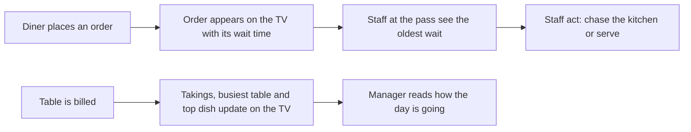

# Scope Document — Manager TV Wall

Built on: `ideation/intent-capture/intent-statement.md` (the problem, viewers, success targets and first exclusions) and the answers in `scope-definition-questions.md`.

## Goal

Give the manager and front-of-house staff at the pass one big screen that shows how service is going at a glance, without touching any device (intent-statement.md, Problem Statement and Target Customer).

## In Scope (this first version)

| # | Capability | Priority | Source |
|---|---|---|---|
| S1 | A staff-only, full-screen TV view for the pass that updates live | Must | intent-statement.md |
| S2 | Live orders, each with how long it has waited, the oldest first, so the oldest wait is always visible | Must | Q2 |
| S3 | Today's takings so far | Must | Q2 |
| S4 | The busiest table today | Must | Q2 |
| S5 | The top dish today | Must | Q2 |
| S6 | A hide-takings setting: hidden by default; any signed-in staff member can show or hide the takings from the staff screens, and the TV follows within a couple of seconds | Must | Q1, Q2 |
| S7 | A link to the TV wall in the staff screens' navigation | Must | Q4 |
| S8 | Open "call the waiter" and "ask for the bill" requests shown on the TV | Could | Q2 |

## Meanings Agreed

- **Today** and **takings** follow the same rules as the existing Sales page, so the TV and the Sales page always show the same figure. (Q3)
- **Busiest table**: the table with the most orders today. (Q3)
- **Top dish**: the dish with the most portions sold today. (Q3)

## Out of Scope

| Item | Status | Source |
|---|---|---|
| Buttons or touch on the TV: it only displays | Left out of this version | intent-statement.md (Q6 of Intent Capture) |
| History and date ranges: it shows today only | Left out of this version | intent-statement.md (Q6 of Intent Capture) |
| Different layouts or settings per screen or per restaurant | Deferred to a later version | Q5 |
| Sound alerts on the TV | Deferred to a later version | Q5 |
| The kitchen team as an audience: the TV is designed for the manager and front-of-house staff | Not a target in this version | intent-statement.md (Target Customer) |

## Changes to v1 and v2

| Screen or behaviour | What changes | Why | Source |
|---|---|---|---|
| Staff screens' navigation | Gains one link to the TV wall | So staff can open the TV wall without typing its address | Q4 |

Nothing else in v1 or v2 changes. Their screens, behaviour and tests stay exactly as they are. (Q4, intent-statement.md Problem Statement)

## Success Targets (carried from the intent)

| Target | Measure |
|---|---|
| Read at a glance | From across the pass, a viewer reads the open orders, the oldest wait, today's takings, the busiest table and the top dish in under 5 seconds (intent-statement.md) |
| Hands-free | Nothing on the TV needs anyone to touch a device (intent-statement.md) |
| Fresh | The TV shows any change within 2 seconds (intent-statement.md) |
| Takings safe by default | When the TV is opened and nobody has shown the takings, no revenue figure appears on it (Q1) |
| v1 and v2 untouched | Every existing v1 and v2 test still passes, and none was changed except where the staff-navigation link makes one out of date (Q4) |

## Value Stream

<!-- Text fallback: A diner places an order; it appears on the TV with its wait time; staff at the pass see the oldest wait and act on it. When a table is billed, takings, busiest table and top dish update on the TV, and the manager reads how the day is going. -->

## Assumptions & Open Questions

- [assumption] There is no hard deadline; capabilities are sequenced value-first.
- [assumption] "From across the pass" means a normal restaurant pass, roughly 2 to 4 metres from a wall-mounted TV; Requirements Analysis pins the exact reading condition.
- [assumption] When the takings are hidden, the space they take on the TV shows a neutral label (for example "Takings hidden") rather than a blank, so staff know the setting is on.
