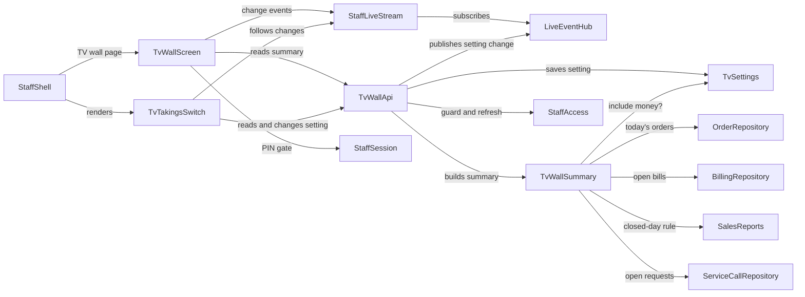

# Component Catalogue: Manager TV Wall

The building blocks for the Manager TV wall. They are built from `inception/requirements-analysis/requirements.md` and `inception/user-stories/stories.md`, on top of the finished app described in `aidlc/spaces/default/codekb/table-order/architecture.md` and `component-inventory.md`.

- Components marked **new** are written for this work.
- Components marked **existing, extended** gain a small, named change.
- Components marked **existing, used** are only read from and do not change.
- The SQLite file and the browser are dependencies of components, not components.
- Deployment stays as it is (one process, one SQLite file), and Units Generation decides how the building blocks are grouped.
- Entities are captured at the ownership and shape level only.

Answer from this stage: one new server read works out the whole TV wall for today in a single answer, and the TV re-reads it when a live event says something changed (Q1).

```yaml
components:
  - name: TvSettings
    summary: new. The restaurant-wide "Show takings on TV" setting.
    behaviour: >
      Keeps one setting for the whole restaurant, saved in the database so it survives a restart.
      It is off (takings hidden) until a staff member turns it on, including on a database upgraded from v2.
      Reading it never fails silently. A missing row reads as off.
    responsibilities:
      - Read and change the show-takings setting
      - Default to hidden on a fresh or upgraded database
    depends_on: []
    dependents:
      - component: TvWallSummary
        interaction: Reads the setting to decide whether money is included in the summary
      - component: TvWallApi
        interaction: Reads and changes the setting for the switch
    external_dependencies:
      - name: SQLite
        kind: database
        purpose: Stores the setting in a new table added by an additive upgrade step
    entities:
      - name: TvSetting
        identifier: key
        attributes: [key, show_takings, updated_at]

  - name: TvWallSummary
    summary: new. Works out everything the TV wall shows for today, in one answer.
    behaviour: >
      Builds one summary from today's rows only (server-local day).
      It holds:
      - Every open order (Pending or Preparing) across all tables, oldest first, with ties broken by order number. Each order has its table, its number, its portions and the time it was placed.
      - Today's takings: tables closed today, using exactly the Sales page's money rules.
      - The money on open tables: the live bills of open visits, cancelled orders left out.
      - The busiest table: most orders placed today, cancelled left out; a tie goes to the lower table number.
      - The top dish: most portions ordered today, cancelled left out; a tie goes to the name first in the alphabet.
      - Open waiter and bill requests, oldest first.
      - The server's current time, so the TV can count waits on the server's clock.
      When the setting is off, both money figures are left out of the answer entirely (not zeroed, not hidden).
    responsibilities:
      - The day-bounded read model behind the TV wall
      - Leaving money out while takings are hidden
    depends_on:
      - component: TvSettings
        interaction: Whether to include money
        style: sync
      - component: OrderRepository
        interaction: Today's orders, their lines and statuses
        style: sync
      - component: BillingRepository
        interaction: Live bills of open visits
        style: sync
      - component: SalesReports
        interaction: The shared rule for a closed day's takings, applied to today only
        style: sync
      - component: ServiceCallRepository
        interaction: Open waiter and bill requests
        style: sync
    dependents:
      - component: TvWallApi
        interaction: Serves the summary to the TV wall
    external_dependencies:
      - name: SQLite
        kind: database
        purpose: Reads today's orders, visits, bills and requests
    entities: []

  - name: TvWallApi
    summary: new. The staff-only server routes for the TV wall and the switch.
    behaviour: >
      Two routes, mounted after the staff guard so a missing staff session is refused with 401:
      - Read the TV wall summary. This read counts as staff activity, so the 12-hour idle sign-out never ends an open TV wall.
      - Change the show-takings setting. Only true or false are accepted; anything else is refused with a validation error.
      After the setting is saved, it publishes a "TV settings changed" event on the staff channel.
      Errors use the app's existing error envelope.
    responsibilities:
      - Staff-only access to the summary and the setting
      - Publishing the setting change after it is saved
    depends_on:
      - component: TvWallSummary
        interaction: Builds the summary to return
        style: sync
      - component: TvSettings
        interaction: Saves the new setting
        style: sync
      - component: StaffAccess
        interaction: Staff guard; the summary read refreshes the idle timer
        style: sync
      - component: LiveEventHub
        interaction: Publishes the setting change to the staff channel
        style: event
    dependents:
      - component: TvWallScreen
        interaction: Reads the summary
      - component: TvTakingsSwitch
        interaction: Reads and changes the setting
    external_dependencies: []
    entities: []

  - name: TvWallScreen
    summary: new. The full-screen TV wall page at /staff/tv, outside the staff navigation.
    behaviour: >
      Shows the summary as drawn in the refined mockups: the orders list with Slow (8 min) and Late (15 min) words, "+N more" and "No open orders"; the oldest wait; takings or "Takings hidden"; the busiest table; the top dish; and the requests strip.
      Re-reads the summary when the shared staff live stream reports an order, table, request or setting change, and on every reconnect.
      Recounts the minutes every 15 seconds on the server's clock. Shows "Reconnecting… last update HH:MM" while the stream is down.
      Takes no input.
    responsibilities:
      - Rendering every TV wall state
      - Keeping the figures fresh from live events
    depends_on:
      - component: TvWallApi
        interaction: Reads the summary
        style: sync
      - component: StaffLiveStream
        interaction: Change events and reconnect notice
        style: event
      - component: StaffSession
        interaction: PIN gate when not signed in
        style: sync
    dependents:
      - component: StaffShell
        interaction: Routes /staff/tv to the TV wall without the navigation
    external_dependencies: []
    entities: []

  - name: TvTakingsSwitch
    summary: new. The "Show takings on TV" switch in the staff navigation.
    behaviour: >
      Shows the current setting as On or Off, changes it on Space, Enter or a click, and returns to the old position if the save fails.
      Follows changes made on other staff screens through the staff live stream.
    responsibilities:
      - Changing the setting from any staff page
    depends_on:
      - component: TvWallApi
        interaction: Reads and changes the setting
        style: sync
      - component: StaffLiveStream
        interaction: Follows changes from other screens
        style: event
    dependents:
      - component: StaffShell
        interaction: Rendered under the TV wall link
    external_dependencies: []
    entities: []

  - name: StaffShell
    summary: existing, extended. The staff navigation and page registry.
    behaviour: >
      Gains one registry entry, "TV wall" (path /staff/tv), whose page renders full screen without the navigation. It also renders the takings switch directly under that link.
      Nothing else in the navigation changes.
    responsibilities:
      - Navigation link and switch placement
      - Full-screen route for the TV wall
    depends_on:
      - component: TvWallScreen
        interaction: The page behind the new entry
        style: sync
      - component: TvTakingsSwitch
        interaction: Rendered in the navigation
        style: sync
    dependents: []
    external_dependencies: []
    entities: []

  - name: StaffLiveStream
    summary: existing, extended. The one shared staff live connection in the browser.
    behaviour: >
      Registers the new "TV settings changed" event name so browsers receive it.
      Nothing else changes.
    responsibilities:
      - Delivering staff events to every staff screen
    depends_on:
      - component: LiveEventHub
        interaction: Subscribes to the staff channel
        style: event
    dependents:
      - component: TvWallScreen
        interaction: Change events
      - component: TvTakingsSwitch
        interaction: Setting changes
    external_dependencies: []
    entities: []

  - name: StaffSession
    summary: existing, used. The PIN screen and the session check in the browser.
    behaviour: >
      Unchanged. Shows the PIN screen when no staff session exists, and returns to the requested page afterwards.
    responsibilities:
      - Sign-in in the browser
    depends_on: []
    dependents:
      - component: TvWallScreen
        interaction: Wraps the TV wall in the PIN gate
    external_dependencies: []
    entities: []

  - name: StaffAccess
    summary: existing, extended. Staff sessions and the staff guard on the server.
    behaviour: >
      Unchanged rules. The TV wall summary route opts into the guard's existing "refresh the idle timer" mode, which other staff reads already use.
    responsibilities:
      - Staff sessions, PIN lockout, the guard
    depends_on: []
    dependents:
      - component: TvWallApi
        interaction: Guards the routes and refreshes the session
    external_dependencies: []
    entities: []

  - name: LiveEventHub
    summary: existing, used. The server's live event channels.
    behaviour: >
      Unchanged. Carries the new event on the existing staff channel.
    responsibilities:
      - Publishing events to subscribed streams
    depends_on: []
    dependents:
      - component: TvWallApi
        interaction: Publishes the setting change
      - component: StaffLiveStream
        interaction: Streams events to staff browsers
    external_dependencies: []
    entities: []

  - name: OrderRepository
    summary: existing, used. Orders, lines and statuses.
    behaviour: >
      Unchanged. Read for today's open orders, order counts per table and portions per dish.
    responsibilities:
      - Order data
    depends_on: []
    dependents:
      - component: TvWallSummary
        interaction: Today's orders
    external_dependencies:
      - name: SQLite
        kind: database
        purpose: Orders and order lines
    entities: []

  - name: BillingRepository
    summary: existing, used. Live bills of open visits.
    behaviour: >
      Unchanged. Its live-bill rule (frozen prices, cancelled left out) gives the "On open tables" figure.
    responsibilities:
      - Bill totals
    depends_on: []
    dependents:
      - component: TvWallSummary
        interaction: Open visits' bills
    external_dependencies:
      - name: SQLite
        kind: database
        purpose: Visits and order lines
    entities: []

  - name: SalesReports
    summary: existing, extended. The Sales page's figures.
    behaviour: >
      Its closed-day takings rule is made callable for a single day, so the TV wall and the Sales page share one rule and always agree.
      The Sales page's own output is unchanged.
    responsibilities:
      - The money rule for a closed day
    depends_on: []
    dependents:
      - component: TvWallSummary
        interaction: Today's closed takings
    external_dependencies:
      - name: SQLite
        kind: database
        purpose: Closed visits
    entities: []

  - name: ServiceCallRepository
    summary: existing, used. Waiter and bill requests.
    behaviour: >
      Unchanged. Read for open requests.
    responsibilities:
      - Service calls
    depends_on: []
    dependents:
      - component: TvWallSummary
        interaction: Open requests
    external_dependencies:
      - name: SQLite
        kind: database
        purpose: Service calls
    entities: []
```

## Component Diagram



<!-- Text fallback: The staff shell opens the TV wall screen and renders the takings switch. Both read through the new TV wall API and listen on the shared staff live stream, which subscribes to the server's live event hub. The API builds the summary with the TV wall summary module, saves the setting with TV settings, uses the staff guard, and publishes setting changes. The summary module reads the setting, today's orders, open bills, the Sales page's closed-day rule and open requests. -->

## Component Summary

| Component | Purpose | Depends On | Dependents | Entities Owned |
|---|---|---|---|---|
| TvSettings (new) | Restaurant-wide show-takings setting | — | TvWallSummary, TvWallApi | TvSetting |
| TvWallSummary (new) | Today's TV wall figures in one answer | TvSettings, OrderRepository, BillingRepository, SalesReports, ServiceCallRepository | TvWallApi | — |
| TvWallApi (new) | Staff-only summary read and setting change | TvWallSummary, TvSettings, StaffAccess, LiveEventHub | TvWallScreen, TvTakingsSwitch | — |
| TvWallScreen (new) | Full-screen TV wall page | TvWallApi, StaffLiveStream, StaffSession | StaffShell | — |
| TvTakingsSwitch (new) | Switch in the staff navigation | TvWallApi, StaffLiveStream | StaffShell | — |
| StaffShell (extended) | Navigation link, switch, full-screen route | TvWallScreen, TvTakingsSwitch | — | — |
| StaffLiveStream (extended) | Registers the new event name | LiveEventHub | TvWallScreen, TvTakingsSwitch | — |
| StaffSession (used) | PIN gate | — | TvWallScreen | — |
| StaffAccess (extended) | Guard; summary read refreshes the session | — | TvWallApi | — |
| LiveEventHub (used) | Live channels | — | TvWallApi, StaffLiveStream | — |
| OrderRepository (used) | Orders | — | TvWallSummary | — |
| BillingRepository (used) | Live bills | — | TvWallSummary | — |
| SalesReports (extended) | Closed-day takings rule, callable for one day | — | TvWallSummary | — |
| ServiceCallRepository (used) | Requests | — | TvWallSummary | — |

## Entity Ownership

| Entity | Owning Component | Identifier | Attributes | References |
|---|---|---|---|---|
| TvSetting | TvSettings | key | key, show_takings, updated_at | — |

The TV wall summary is a read model built on request, not a stored entity. Orders, visits, bills and requests stay owned by their existing components.

## External Dependencies

| Component | Dependency | Kind | Purpose |
|---|---|---|---|
| TvSettings | SQLite | database | New settings table (additive upgrade step) |
| TvWallSummary | SQLite | database | Today's orders, visits, bills, requests |
| OrderRepository, BillingRepository, SalesReports, ServiceCallRepository | SQLite | database | Existing tables, unchanged |

## Rationale

| Component | Why it is its own building block |
|---|---|
| TvSettings | Distinct data ownership: the only new stored fact, with its own default and lifetime |
| TvWallSummary | Distinct concern: a day-bounded read model across four existing areas; keeping it apart from the routes makes it testable without HTTP |
| TvWallApi | Distinct boundary: staff guard, input checks and event publishing, following the app's "routes validate, then publish after the write" pattern |
| TvWallScreen | Distinct lifecycle: a full-screen page with its own refresh and clock, outside the navigation |
| TvTakingsSwitch | Distinct placement: lives in the navigation on every staff page, not on the TV wall |
| Existing components | Kept as they are. The small extensions (registry entry, event name, idle refresh, single-day sales rule) are named so Code Generation changes nothing else |

### Component-boundary options (Q1)

- **Option A: one summary read (chosen).**
  - Pros: one request per change; today's rows only (NFR6); the money is left out on the server while hidden (FR6.3); simple to test.
  - Cons: a new read model to keep in step with the Sales page's rules.
  - Reversibility: high.
- **Option B: combine existing reads in the browser.**
  - Pros: no new server read.
  - Cons: one request per table plus the full-history sales read on every change; money would reach the browser even while hidden; the busiest table and top dish have no existing read.
  - Reversibility: high.
- **Option C: push the summary in events.**
  - Pros: no re-read.
  - Cons: events become large; a missed event leaves the TV wrong until reconnect; money would ride on the shared staff channel to every staff screen.
  - Reversibility: medium.
- **Recommendation and team choice:** A, because it keeps money off the wire when hidden and reads only today's rows.

**Alternatives Rejected:** B and C, for the reasons above (ADR-001).
