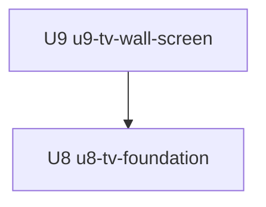

# Unit Dependencies — Manager TV Wall

The dependency graph (topology only) between this work's two Units, built from `inception/domain-design/components.md` and the Units in `unit-of-work.md`. Delivery Planning decides the order and why.

## Dependency Graph

- **U8 `u8-tv-foundation`** depends on no other Unit of this work. It builds on the finished v1 and v2 app as it stands.
- **U9 `u9-tv-wall-screen`** depends on **U8**. Its code and tests need U8's summary read, setting routes, live event and the `/staff/tv` route.
- U8 is the walking skeleton. It runs on its own, end to end: the plain TV wall page shows live data from the new summary read, and the navigation switch hides and shows the money on it. U9 then replaces the plain page with the finished screen.



<!-- Text fallback: U9 depends on U8. U8 depends on no Unit of this work. The graph has no cycles. -->

```yaml
units:
  - name: u8-tv-foundation
    kind: service
    depends_on: []
  - name: u9-tv-wall-screen
    kind: ui
    depends_on: [u8-tv-foundation]
```

## Integration Points

| Between | What crosses | How |
|---|---|---|
| U9 and U8 | The TV wall summary (orders, figures, setting value, server time), the "TV settings changed" event, and the existing order, table and request events | U8's staff routes and the shared staff live stream; pinned in Contract Design |
| U8 and v1/v2 | Orders, visits, bills, requests, the Sales rule, the staff guard, the page registry, the event list | Extended only as `unit-of-work.md` names |

## Parallel Development Opportunities

None. U9 depends on U8, so there is only one valid order: U8, then U9.

## Assumptions & Open Questions

- U8's plain TV wall page is replaced by U9's finished screen. U9 keeps U8's page route and data hook, so no U8 test about the data flow needs to change.
